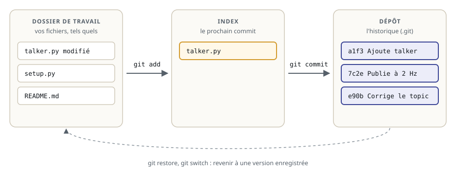
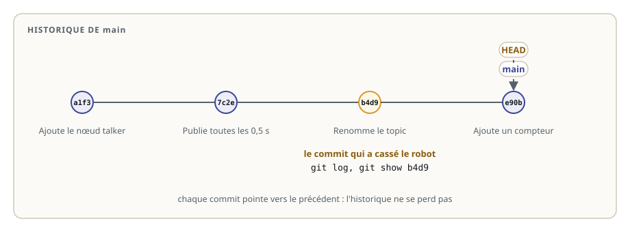
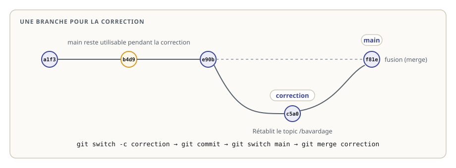
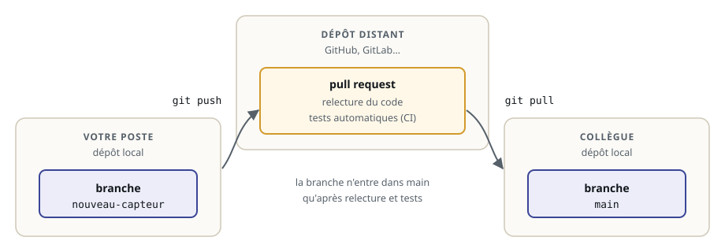

# Versionner son code avec Git

> **La situation.** Hier soir, le robot de livraison publiait ses messages. Ce matin, plus rien n'arrive sur `/bavardage`, et trois personnes ont modifié le code entre-temps. Qui a changé quoi, quand, et pourquoi ? Sans outil, impossible de le savoir. Avec **Git**, chaque modification est enregistrée, datée, signée et commentée : on retrouve le changement fautif en quelques commandes, on le corrige sans rien perdre, et on partage la correction avec l'équipe.

**Dans ce module, vous allez :**

- comprendre les trois zones de Git : le dossier de travail, l'index et le dépôt ;
- enregistrer votre travail en **commits** avec de bons messages ;
- lire l'**historique** pour retrouver le commit qui a cassé le robot ;
- corriger sur une **branche**, puis la **fusionner** ;
- comprendre comment une équipe travaille ensemble : dépôt distant, `push`, `pull` et **pull request**.

## L'essentiel en théorie

- Un **dépôt** Git est un dossier dont Git garde l'historique, dans un sous-dossier caché `.git`.
- Un **commit** est une photo enregistrée du projet, avec un auteur, une date et un message. Les commits forment une chaîne : l'**historique**.
- Avant d'être commitée, une modification passe par l'**index** (`git add`) : on choisit précisément ce qui part dans le commit.
- Une **branche** est une ligne de travail parallèle. On y corrige ou on y développe sans toucher `main`, puis on la **fusionne**.
- À plusieurs, chacun a son dépôt ; un **dépôt distant** (GitHub, GitLab) les relie. Le code entre dans `main` après **relecture** et **tests**, par une **pull request**.

## 1. Pourquoi versionner le code d'un robot

Le logiciel d'un robot change sans arrêt : un réglage de vitesse, un nouveau capteur, un nom de topic. Le jour où le robot ne fait plus ce qu'on attend, la première question est toujours la même : **qu'est-ce qui a changé ?** Git y répond, et permet :

- de **revenir** à une version qui marchait ;
- de savoir **qui** a fait un changement et **pourquoi** (le message du commit) ;
- de travailler à **plusieurs** sur le même code sans s'écraser ;
- de **tester** et faire **relire** chaque changement avant qu'il arrive sur le robot.

C'est l'outil de base de toute équipe logicielle, en robotique comme ailleurs. Les packages ROS 2 que vous utilisez (Nav2, MoveIt 2, ROS 2 lui-même) sont développés ainsi, en public, sur GitHub.

## 2. Les trois zones

Git distingue trois endroits :



- le **dossier de travail** : vos fichiers, tels que vous les modifiez ;
- l'**index** (ou *staging area*) : ce que vous avez choisi d'inclure dans le prochain commit ;
- le **dépôt** : l'historique des commits, rangé dans `.git`.

`git add` fait passer une modification du dossier de travail à l'index ; `git commit` enregistre l'index dans le dépôt. Ce passage en deux temps permet de faire des commits **ciblés** : si vous avez corrigé un bug et ajouté un réglage, faites-en deux commits.

## 3. Premiers pas

Une seule fois par poste, dites à Git qui vous êtes : votre nom et votre adresse apparaîtront dans chaque commit.

```bash
git config --global user.name "Prénom Nom"
git config --global user.email "vous@exemple.fr"
```

Puis, dans le dossier du projet (dans le lab : `~/ws/15-git`) :

```bash
cd ~/ws/15-git
git init -b main                  # crée le dépôt, branche main
git status                        # que se passe-t-il ?
```

`git status` est la commande à lancer sans modération : elle dit sur quelle branche vous êtes, ce qui est modifié et ce qui est prêt à être commité.

Les dossiers `build/`, `install/` et `log/` sont **produits** par `colcon build` (module 4) : on ne les versionne pas. Un fichier `.gitignore` le dit à Git :

```bash
printf 'build/\ninstall/\nlog/\n' > .gitignore
```

On peut alors enregistrer un premier commit :

```bash
git add .gitignore src
git status                        # les fichiers sont dans l'index
git commit -m "Ajoute le package demo_pkg"
```

**Un bon message de commit** dit *ce que fait* le changement, en une ligne courte, à l'impératif : « Corrige le nom du topic de vitesse », « Ajoute le paramètre vitesse_max ». « Modifs » ou « wip » ne disent rien au collègue qui lira l'historique dans six mois, ni à vous.

## 4. Lire l'historique

Chaque commit pointe vers le précédent : l'historique est une chaîne.



Trois commandes pour l'explorer :

```bash
git log --oneline                 # un commit par ligne : identifiant court et message
git log --format='%h %an %ad %s' --date=short   # avec l'auteur et la date
git show b4d9                     # le détail d'un commit : qui, quand, quelles lignes
git diff                          # ce qui a changé depuis le dernier commit
```

Dans `git show` et `git diff`, les lignes retirées commencent par `-`, les lignes ajoutées par `+`. Pour savoir quand une ligne précise a changé, `git log -p -- src/demo_pkg/demo_pkg/talker.py` montre l'historique d'un seul fichier, modifications comprises.

`main` et `HEAD` sont des **étiquettes** : `main` désigne le dernier commit de la branche, `HEAD` l'endroit où vous êtes. Un identifiant de commit (`b4d9…`) est unique : il suffit de ses premiers caractères.

## 5. Corriger sur une branche

On ne corrige pas directement sur `main`, la version que toute l'équipe utilise : on crée une **branche**, on y travaille, on vérifie, puis on la fusionne.



```bash
git switch -c correction          # crée la branche correction et s'y place
# … corriger le fichier, recompiler, vérifier que le robot marche …
git add src/demo_pkg/demo_pkg/talker.py
git commit -m "Rétablit le topic /bavardage"
git switch main                   # revient sur main
git merge correction              # fusionne la correction dans main
git branch                        # liste les branches ; * marque la branche courante
```

Deux façons de corriger un commit fautif, sans jamais effacer l'historique :

- **modifier le fichier** et commiter la correction, comme ci-dessus ;
- **annuler le commit** avec `git revert <identifiant>` : Git crée un nouveau commit qui fait exactement l'inverse du commit fautif.

À éviter sur une branche partagée : `git reset --hard`, qui efface des commits. Si un collègue les a déjà récupérés, vos historiques divergent ; et vous perdez au passage les commits utiles qui suivaient le commit fautif.

## 6. Travailler à plusieurs

En équipe, chacun travaille dans son propre dépôt, et un **dépôt distant**, hébergé sur GitHub ou GitLab par exemple, sert de point de rendez-vous.



```bash
git clone https://github.com/equipe/robot-livraison.git    # récupérer le dépôt une première fois
git switch -c nouveau-capteur                              # une branche par sujet
git push -u origin nouveau-capteur                         # envoyer la branche
git pull                                                   # récupérer le travail des autres
```

La branche envoyée, on ouvre une **pull request** (ou *merge request*) : une demande de fusion dans `main`. C'est là que se fait le travail d'équipe :

- un collègue **relit le code** et le commente ligne par ligne ;
- les **tests automatiques** (l'intégration continue, ou CI) compilent le code et lancent les tests ;
- la branche n'est fusionnée qu'une fois relue et testée.

C'est ainsi que les projets ROS 2 open source acceptent les contributions. Le parcours « Tester et fiabiliser », bientôt disponible, montre comment écrire ces tests et les faire tourner automatiquement.

## 7. Les bons réflexes

- `git status` avant chaque commit ;
- des commits **petits** et **cohérents** : un sujet par commit, un message qui le dit ;
- jamais de `build/`, `install/`, `log/` ni de fichiers lourds dans le dépôt : c'est le rôle de `.gitignore` ;
- jamais de **secrets** (mots de passe, clés d'API) dans un commit : une fois poussés, ils restent dans l'historique ;
- une branche par sujet, fusionnée après vérification ;
- on corrige par un nouveau commit, on ne réécrit pas l'historique partagé.

## À vous de jouer

Dans l'exercice, vous recevez le dépôt de l'équipe du robot : quatre commits, et un robot qui ne publie plus sur `/bavardage`. Retrouvez le commit fautif dans l'historique, corrigez-le sur une branche `correction`, fusionnez-la dans `main`, et vérifiez que le robot publie de nouveau, sans perdre le travail des autres.
