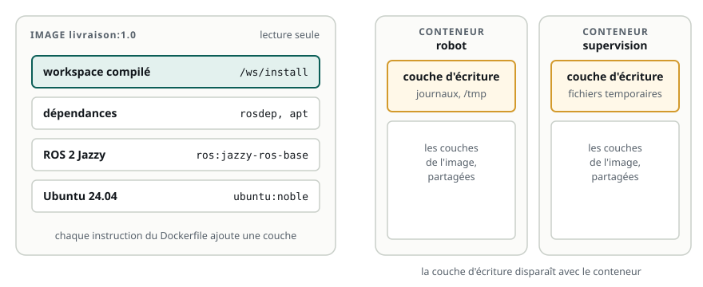

# Pourquoi des conteneurs en robotique

> **La situation.** Le logiciel du robot de livraison tourne sur trois sortes de machines : les ordinateurs des développeurs, le serveur d'intégration continue qui lance les tests, et l'ordinateur embarqué du robot. Chaque semaine, quelque chose casse sur l'une et pas sur les autres : une version de bibliothèque différente, un package oublié, une variable d'environnement. Avant d'écrire l'image du robot dans le module suivant, vous allez comprendre ce qu'est un conteneur et pourquoi presque toutes les équipes robotiques en utilisent.

**Dans ce module, vous allez :**

- comprendre le problème que règlent les conteneurs : un environnement **reproductible** ;
- distinguer **image**, **conteneur** et **registre** ;
- comprendre les **couches** d'une image et ce qui disparaît quand un conteneur s'arrête ;
- choisir parmi les **images officielles de ROS 2** ;
- savoir ce que Docker ne fait pas : ce n'est ni une machine virtuelle, ni une solution au temps réel.

C'est un module de cours : il se termine par un QCM. Le lab ne contient pas Docker (chaque lab est déjà un conteneur) : les commandes de ce module sont à refaire chez vous, sur une machine où Docker est installé.

## L'essentiel en théorie

- Une **image** est un modèle figé : un système de fichiers complet (Ubuntu, ROS 2, vos dépendances, votre code compilé) et la commande à lancer. Elle ne change jamais.
- Un **conteneur** est une image **en cours d'exécution** : des processus isolés, avec leur propre système de fichiers, qui partagent le **noyau** de la machine hôte.
- Une image est faite de **couches** empilées ; un conteneur ajoute au-dessus une couche d'écriture, **perdue** quand on le supprime.
- Un **registre** (Docker Hub, GitHub Container Registry…) stocke et distribue les images, identifiées par un **nom** et un **tag** (`ros:jazzy`).
- Le même `docker run` donne le même environnement sur le portable, en CI et sur le robot : c'est la **reproductibilité**.

## 1. « Ça marche sur ma machine »

Le logiciel d'un robot dépend de beaucoup de choses qui ne sont pas dans son dépôt Git :

- la **distribution ROS** (Humble, Jazzy) et la version d'Ubuntu qui va avec ;
- des dizaines de **packages système** (`apt`) : pilotes de capteurs, OpenCV, Eigen, bibliothèques DDS ;
- des **bibliothèques Python** (`pip`) avec leurs versions ;
- des **variables d'environnement** : `ROS_DOMAIN_ID`, `RMW_IMPLEMENTATION`, et le `source` des bons `setup.bash` ;
- des **fichiers de configuration** : paramètres des nœuds, calibrations.

Chaque machine finit par avoir sa propre combinaison. Le développeur a une version plus récente d'une bibliothèque, la CI en a une plus ancienne, le robot a reçu une mise à jour à la main il y a six mois. Le même code ne se comporte plus de la même façon, et l'on perd des journées à chercher pourquoi.

Un **conteneur** emporte tout cet environnement avec lui. On décrit une fois, dans un fichier, comment le construire ; on obtient une **image**, identique partout où on la lance.

## 2. Image, conteneur, registre



**L'image** est le modèle. Elle contient un système de fichiers complet et des métadonnées : la commande lancée au démarrage, les variables d'environnement, le dossier de travail. Elle est **en lecture seule** : on ne la modifie jamais, on en construit une nouvelle.

**Le conteneur** est une instance de l'image : on peut en lancer plusieurs depuis la même image, comme on lance plusieurs fois le même programme. Chacun a ses processus, son système de fichiers et, en général, son réseau, **isolés** de ceux de l'hôte et des autres conteneurs.

**Le registre** distribue les images. On y **pousse** (`push`) une image construite, on la **tire** (`pull`) sur une autre machine. Une image se désigne par `nom:tag` :

| Désignation | Signification |
|---|---|
| `ros:jazzy` | l'image officielle `ros`, tag `jazzy` |
| `ghcr.io/mon-equipe/livraison:1.4.0` | l'image `livraison` de l'équipe, version 1.4.0, sur GitHub |
| `ros@sha256:4f3c…` | une version précise et immuable, par son empreinte (*digest*) |

Un tag peut être déplacé (`latest`, `jazzy` changent quand une nouvelle version sort) ; une empreinte, jamais. Pour un robot en production, on note la version exacte qu'il fait tourner.

## 3. Les couches

Une image n'est pas un gros fichier unique : c'est une **pile de couches**. Chaque instruction du fichier de construction (le `Dockerfile`, au module suivant) ajoute une couche : installer des packages, copier le code, compiler.

Cela a trois conséquences pratiques :

- **le partage** : dix images construites sur `ros:jazzy` partagent ses couches ; elles ne sont stockées et téléchargées qu'une fois ;
- **le cache** : si une étape n'a pas changé, sa couche est réutilisée ; seules les étapes suivantes sont refaites. L'ordre des instructions compte donc beaucoup (module suivant) ;
- **l'éphémère** : ce qu'un conteneur écrit va dans sa couche d'écriture, détruite avec lui. Les données à garder (enregistrements `ros2 bag`, cartes, journaux) vont dans un **volume** ou un dossier de l'hôte monté dans le conteneur.

```text
# Un conteneur jetable : tout ce qu'il écrit disparaît à la sortie (--rm)
docker run --rm -it ros:jazzy bash

# Un dossier de l'hôte monté dans le conteneur : les enregistrements restent
docker run --rm -it -v ~/bags:/bags ros:jazzy bash
```

## 4. Un conteneur n'est pas une machine virtuelle

Une machine virtuelle émule un ordinateur complet et démarre son propre noyau. Un conteneur, lui, n'est qu'un ensemble de **processus ordinaires** de l'hôte, que le noyau Linux isole (espaces de noms) et limite (cgroups : processeur, mémoire).

| | Machine virtuelle | Conteneur |
|---|---|---|
| Noyau | le sien | celui de l'hôte |
| Démarrage | dizaines de secondes | une fraction de seconde |
| Taille | plusieurs Go | quelques centaines de Mo à quelques Go |
| Performances | un peu moins bonnes | celles de l'hôte |
| Accès au matériel | émulé ou transmis | direct, si on l'autorise |

Pour un robot, c'est une bonne nouvelle : un nœud dans un conteneur va aussi vite que hors du conteneur, et peut accéder à un lidar USB ou à une carte graphique si on le lui permet (module 3). Deux limites à connaître :

- l'image doit correspondre à l'**architecture** du processeur : une image `amd64` (PC) ne tourne pas sur un Raspberry Pi ou un Jetson (`arm64`). Les images officielles de ROS existent pour les deux ;
- Docker n'apporte **pas le temps réel** : un contrôleur de moteurs à 1 kHz demande un noyau temps réel sur l'hôte, conteneur ou pas.

## 5. Les images officielles de ROS 2

Inutile de partir d'une Ubuntu vide : ROS 2 est publié en images prêtes à l'emploi.

| Image | Contenu | Usage |
|---|---|---|
| `ros:jazzy-ros-core` | le strict minimum : rclcpp, rclpy, les messages de base et la commande `ros2` | une image de production très légère |
| `ros:jazzy-ros-base` (= `ros:jazzy`) | ros-core, plus `ros2 bag`, TF2, `robot_state_publisher`, et les outils de compilation `colcon` et `rosdep` | **le point de départ habituel** |
| `osrf/ros:jazzy-desktop` | ros-base, plus RViz, rqt et les démos | un poste de développement |
| `osrf/ros:jazzy-desktop-full` | desktop, plus Gazebo | la simulation |

Règle simple : on part de l'image **la plus petite qui suffit**. Une image de robot n'a pas besoin de RViz ni de Gazebo ; une image de développement, si. Le module suivant construit justement deux images à partir du même code.

## 6. Ce que Docker change dans une équipe robotique

- **Développement** : chaque développeur lance le même environnement, quelle que soit sa machine (même sous macOS ou Windows, Docker fait tourner Linux).
- **Intégration continue** : les tests tournent dans l'image du robot ; ce qui passe en CI passe sur le robot.
- **Déploiement** : on n'installe plus le robot à la main ; on lui envoie une image, et l'on peut revenir à la précédente en une commande (module 4).
- **Plusieurs versions côte à côte** : un conteneur Humble et un conteneur Jazzy sur la même machine, sans conflit.

Ce lab en est un exemple : chaque étudiant reçoit un conteneur créé depuis la même image, qui contient ROS 2 Jazzy, Gazebo et RViz, et son dossier personnel monté comme un volume.

## 7. À refaire chez vous

Sur une machine avec Docker (Docker Desktop sous Windows et macOS, `docker.io` sous Ubuntu) :

```text
docker pull ros:jazzy                     # télécharge l'image (et ses couches)
docker image ls                           # les images présentes, et leur taille
docker run --rm -it ros:jazzy bash        # un terminal dans un conteneur Jazzy
ros2 run demo_nodes_cpp talker            # dans le conteneur : ROS 2 fonctionne déjà
docker ps                                 # depuis un autre terminal : les conteneurs en cours
docker exec -it <nom> bash                # un second terminal dans le même conteneur
docker image history ros:jazzy            # les couches de l'image
```

## 8. À retenir

| Mot | Définition |
|---|---|
| Image | modèle figé et en lecture seule : système de fichiers, commande, variables |
| Conteneur | une image en cours d'exécution : des processus isolés, sur le noyau de l'hôte |
| Couche | une étape de construction ; partagée entre images, réutilisée par le cache |
| Volume | un stockage qui survit au conteneur (enregistrements, cartes, journaux) |
| Registre | le serveur qui stocke et distribue les images (`push`, `pull`) |
| Tag, empreinte | `ros:jazzy` peut changer ; `@sha256:…` désigne une version exacte |

**Et maintenant ?** Vous savez ce qu'est une image. Le module suivant vous fait écrire celle du robot de livraison : un `Dockerfile`, une compilation en deux étapes et le script qui démarre ROS dans le conteneur.
