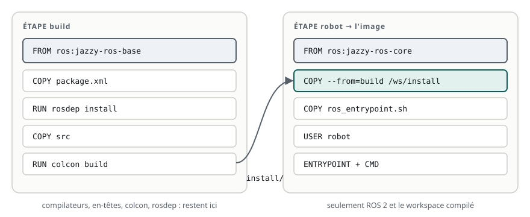

# Écrire l'image de son robot

> **La situation.** Le robot de livraison doit maintenant être livré sous forme d'image : un seul `docker run` doit démarrer tout son logiciel, sur n'importe quelle machine. Vous allez écrire son `Dockerfile` : la recette qui part d'une image ROS 2, installe les dépendances, compile le workspace et décide de ce qui se lance au démarrage du conteneur.

**Dans ce module, vous allez :**

- lire et écrire un **Dockerfile** : `FROM`, `WORKDIR`, `COPY`, `RUN`, `ENV`, `USER` ;
- installer les dépendances d'un workspace avec **rosdep** ;
- construire l'image en **deux étapes** : compiler dans une image complète, exécuter dans une image légère ;
- **ordonner les couches** pour que le cache de Docker fasse gagner du temps ;
- comprendre le **point d'entrée** (`ENTRYPOINT`) et la **commande** (`CMD`) : ce qui charge ROS et le workspace avant de lancer le robot.

Le lab n'a pas Docker : vous écrivez les fichiers ici, et **Vérifier** simule le démarrage du conteneur à partir de votre `Dockerfile`. Les commandes `docker` sont à refaire chez vous.

## L'essentiel en théorie

- Un **Dockerfile** est une suite d'instructions ; chacune ajoute une **couche** à l'image.
- On part d'une image ROS officielle (`FROM ros:jazzy-ros-base`), on **copie** le code (`COPY`), on **exécute** des commandes de construction (`RUN rosdep install`, `RUN colcon build`).
- Une construction **en deux étapes** (*multi-stage*) compile dans une première image, puis copie seulement `install/` dans une image d'exécution sans compilateur.
- Docker réutilise les couches qui n'ont pas changé : on copie d'abord ce qui change **rarement** (les `package.xml`), ensuite ce qui change **souvent** (le code).
- Au démarrage, Docker lance `ENTRYPOINT` suivi de `CMD`. Le point d'entrée doit **sourcer ROS puis le workspace**, avant de lancer la commande par `exec "$@"`.

## 1. Le dossier du robot

Le lab de ce module contient le package `livraison_bringup` : un nœud `etat`, qui annonce que le robot est prêt puis publie son état, et un fichier de lancement `robot.launch.py`. Dans le vrai robot, ce fichier de lancement démarre tous les nœuds : pilotes, localisation, navigation.

```bash
cd ~/ws/21-docker-image
colcon build
source install/setup.bash
ros2 launch livraison_bringup robot.launch.py
```

Le but de ce module : obtenir le même résultat avec un seul `docker run`, sans `colcon build` ni `source` à la main. Le dossier de construction de l'image (le **contexte**) est la racine du workspace :

```text
21-docker-image/
├── Dockerfile               la recette de l'image
├── docker/
│   └── ros_entrypoint.sh    le point d'entrée du conteneur
└── src/
    └── livraison_bringup/   le code du robot
```

## 2. Les instructions d'un Dockerfile

| Instruction | Rôle | Exemple |
|---|---|---|
| `FROM` | l'image de départ (et le nom d'une étape) | `FROM ros:jazzy-ros-base AS build` |
| `WORKDIR` | le dossier courant des instructions suivantes, créé si besoin | `WORKDIR /ws` |
| `COPY` | copie des fichiers du contexte (ou d'une autre étape) dans l'image | `COPY src src` |
| `RUN` | exécute une commande pendant la construction ; son résultat devient une couche | `RUN colcon build` |
| `ENV` | une variable d'environnement, dans l'image et dans le conteneur | `ENV ROS_DOMAIN_ID=42` |
| `USER` | l'utilisateur des instructions suivantes et du conteneur | `USER robot` |
| `ENTRYPOINT` | le programme lancé au démarrage du conteneur | `ENTRYPOINT ["/ros_entrypoint.sh"]` |
| `CMD` | les arguments par défaut, passés au point d'entrée | `CMD ["ros2", "launch", …]` |

`RUN` s'exécute **à la construction** (`docker build`) ; `ENTRYPOINT` et `CMD`, **au démarrage** (`docker run`). C'est la différence la plus importante à retenir.

## 3. Les dépendances avec rosdep

Un package déclare ses dépendances dans `package.xml` (`<depend>`, `<exec_depend>`…). **rosdep** les lit et installe les paquets système correspondants (`apt`) :

```text
rosdep install --from-paths src --ignore-src -y
```

- `--from-paths src` : lit les `package.xml` de tous les packages de `src/` ;
- `--ignore-src` : n'essaie pas d'installer les packages déjà présents dans `src/` ;
- `-y` : répond oui à `apt`, indispensable dans une construction sans clavier.

Dans une image, on nettoie ensuite la liste des paquets d'`apt` (`rm -rf /var/lib/apt/lists/*`) **dans la même instruction `RUN`** : sinon elle reste dans une couche et alourdit l'image pour rien.

## 4. Deux étapes : compiler, puis exécuter



Compiler demande des outils lourds (compilateurs, en-têtes, `colcon`, `rosdep`) dont le robot n'a pas besoin pour **exécuter** le résultat. Une construction en deux étapes les sépare :

1. l'étape `build` part de `ros:jazzy-ros-base`, installe les dépendances et compile dans `/ws` ;
2. l'étape `robot` part de `ros:jazzy-ros-core`, plus légère, et ne reçoit que `/ws/install`, avec `COPY --from=build`.

Seule la **dernière étape** devient l'image. Elle est plus petite (moins de place sur le robot, mises à jour plus rapides) et contient moins de programmes inutiles (moins de failles possibles).

Le Dockerfile complet du robot :

```dockerfile fichier=Dockerfile
# syntax=docker/dockerfile:1
# Image du robot de livraison, en deux étapes : on compile dans une image complète,
# puis on ne garde que le résultat dans une image d'exécution plus petite.

# --- Étape 1 : compilation
FROM ros:jazzy-ros-base AS build
WORKDIR /ws
# Les dépendances d'abord : cette couche reste en cache tant que package.xml ne change pas
COPY src/livraison_bringup/package.xml src/livraison_bringup/package.xml
RUN apt-get update \
 && rosdep install --from-paths src --ignore-src -y \
 && rm -rf /var/lib/apt/lists/*
# Puis le code, qui change souvent
COPY src src
RUN . /opt/ros/$ROS_DISTRO/setup.sh && colcon build

# --- Étape 2 : exécution, sans les outils de compilation
FROM ros:jazzy-ros-core AS robot
COPY --from=build /ws/install /ws/install
COPY --chmod=755 docker/ros_entrypoint.sh /ros_entrypoint.sh
RUN useradd --create-home robot
USER robot
ENTRYPOINT ["/ros_entrypoint.sh"]
CMD ["ros2", "launch", "livraison_bringup", "robot.launch.py"]
```

Trois détails :

- `. /opt/ros/$ROS_DISTRO/setup.sh` avant `colcon build` : chaque `RUN` est un nouveau shell, rien n'est « sourcé » d'une instruction à l'autre. Les images ROS définissent `ROS_DISTRO` (ici `jazzy`) ;
- `COPY --chmod=755` rend le point d'entrée exécutable dans l'image, quels que soient les droits du fichier sur votre disque ;
- `USER robot` : le conteneur ne tourne pas en `root`. Si un nœud a une faille, elle ne donne pas tous les droits dans le conteneur.

Si vos packages ont d'autres dépendances d'exécution que celles de `ros-core` (OpenCV, un pilote…), installez-les aussi dans l'étape `robot`, avec `apt-get install`.

## 5. L'ordre des couches et le cache

À chaque `docker build`, Docker reprend les couches de la construction précédente **tant que l'instruction et les fichiers qu'elle utilise n'ont pas changé**. Dès qu'une couche change, toutes les suivantes sont refaites.

D'où l'ordre du Dockerfile : d'abord `package.xml` et `rosdep install` (les dépendances changent rarement), ensuite `COPY src src` et `colcon build` (le code change à chaque fois). Modifier une ligne de `etat.py` ne relance que la compilation, pas les minutes d'installation de paquets.

Dans l'autre ordre (`COPY src src` puis `rosdep install`), chaque modification du code réinstallerait toutes les dépendances.

Un fichier `.dockerignore`, à la racine du contexte, exclut ce qui ne doit jamais partir dans l'image : il évite d'envoyer des centaines de Mo à Docker et de casser le cache.

```text
build/
install/
log/
.git/
```

## 6. Le point d'entrée : ENTRYPOINT et CMD

Au démarrage, Docker lance le **point d'entrée** suivi de la **commande** :

```text
ENTRYPOINT ["/ros_entrypoint.sh"]
CMD ["ros2", "launch", "livraison_bringup", "robot.launch.py"]
→ /ros_entrypoint.sh ros2 launch livraison_bringup robot.launch.py
```

Le conteneur démarre comme un terminal neuf : **aucun `setup.bash` n'est sourcé**. C'est le rôle du point d'entrée : préparer l'environnement, puis passer la main à la commande.

```bash fichier=docker/ros_entrypoint.sh
#!/bin/bash
# Point d'entrée du conteneur : prépare l'environnement ROS, puis lance la commande (CMD).
set -e
source "/opt/ros/$ROS_DISTRO/setup.bash"
source /ws/install/setup.bash
exec "$@"
```

- `source "/opt/ros/$ROS_DISTRO/setup.bash"` : ROS 2 lui-même (l'**underlay**) ;
- `source /ws/install/setup.bash` : le workspace du robot (l'**overlay**), comme au module « Organiser son code » ;
- `exec "$@"` : remplace le script par la commande reçue. Sans `exec`, le script resterait le processus principal du conteneur et `docker stop` n'atteindrait pas proprement `ros2 launch` ;
- `set -e` : si un `source` échoue, le conteneur s'arrête avec une erreur claire au lieu de continuer à moitié configuré.

La commande se remplace au lancement, le point d'entrée reste :

```text
docker run --rm livraison:dev                                # CMD par défaut : ros2 launch …
docker run --rm -it livraison:dev bash                       # un terminal, ROS et le workspace déjà chargés
docker run --rm livraison:dev ros2 run livraison_bringup etat
```

## 7. À refaire chez vous

Copiez le dossier `~/ws/21-docker-image` (sans `build/`, `install/` ni `log/`) sur une machine avec Docker, puis :

```text
docker build -t livraison:dev .                 # construit l'image (le « . » est le contexte)
docker image ls livraison                       # sa taille
docker run --rm livraison:dev                   # démarre le robot
docker build -t livraison:dev .                 # sans changement : tout vient du cache
docker build --target build -t livraison:build . # s'arrêter à l'étape de compilation, pour déboguer
```

## 8. À retenir

| Notion | En une phrase |
|---|---|
| `RUN` / `CMD` | `RUN` agit à la construction, `CMD` au démarrage du conteneur |
| Deux étapes | compiler dans `ros-base`, n'emporter que `install/` dans `ros-core` |
| Cache | ce qui change rarement d'abord (`package.xml`, `rosdep`), le code ensuite |
| Point d'entrée | `source` ROS, `source` le workspace, puis `exec "$@"` |
| Sécurité | un utilisateur non `root` (`USER`), une image sans outils inutiles |

**Et maintenant ?** L'image démarre un robot. Mais un robot, c'est plusieurs programmes, parfois sur plusieurs machines. Le module suivant les assemble avec Docker Compose, et règle la question du réseau pour que DDS les fasse se découvrir.
