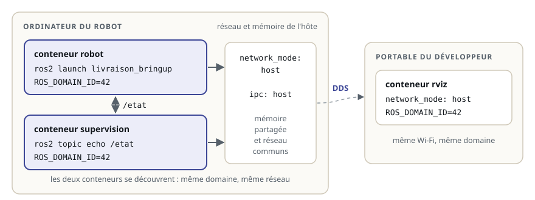

# Plusieurs conteneurs : Compose et DDS

> **La situation.** Sur l'ordinateur du robot de livraison tournent maintenant deux conteneurs : `robot`, qui démarre ses nœuds, et `supervision`, qui suit son état pour l'afficher à l'équipe. Demain s'y ajouteront l'enregistrement des données et la navigation, et un développeur voudra voir le robot dans RViz depuis son portable. Lancer chaque conteneur à la main avec dix options ne tiendra pas : vous allez tout décrire dans un fichier `compose.yaml`, et comprendre comment ROS 2 traverse les conteneurs.

**Dans ce module, vous allez :**

- décrire plusieurs conteneurs dans un **compose.yaml** et les piloter avec `docker compose` ;
- comprendre les **trois conditions** pour que DDS fasse communiquer des nœuds dans des conteneurs ;
- donner à un conteneur l'accès au **matériel** (lidar, caméra) et à l'**affichage** (RViz) ;
- relier le robot et un **poste de développement**.

Comme au module précédent, le lab n'a pas Docker : **Vérifier** simule `docker compose up` à partir de votre fichier.

## L'essentiel en théorie

- **Docker Compose** décrit, dans un fichier `compose.yaml`, des **services** : chacun est un conteneur, avec son image, sa commande, ses variables, ses volumes. `docker compose up` les démarre tous.
- Des nœuds ROS 2 se découvrent par **DDS**. Dans des conteneurs, il faut : le **même `ROS_DOMAIN_ID`**, un **réseau commun** (le plus simple : `network_mode: host`) et, sur une même machine, la **mémoire partagée** (`ipc: host`).
- Un conteneur n'a accès à un périphérique que si on le lui donne (`devices`), et à l'écran que si on lui passe l'affichage (`DISPLAY` et le socket X11).
- `restart: unless-stopped` relance un service après une panne ou un redémarrage du robot.

## 1. Un fichier pour tous les conteneurs



Sans Compose, chaque conteneur se lance avec une longue ligne :

```text
docker run -d --name robot --network host --ipc host --restart unless-stopped \
  -e ROS_DOMAIN_ID=42 -v ./bags:/bags ghcr.io/roboforge/livraison:1.0 \
  ros2 launch livraison_bringup robot.launch.py
```

Le fichier `compose.yaml` décrit la même chose, pour tous les services, et se range dans Git avec le code :

```yaml fichier=compose.yaml
# Le robot de livraison et sa supervision, chacun dans son conteneur, sur l'ordinateur du robot.
# Réglages communs aux deux services (ancre YAML, reprise par « <<: *ros »).
x-ros: &ros
  image: ghcr.io/roboforge/livraison:1.0
  network_mode: host        # DDS voit les autres nœuds comme hors conteneur
  ipc: host                 # mémoire partagée de DDS entre conteneurs de la même machine
  restart: unless-stopped   # redémarre après une panne ou un redémarrage du robot

services:
  robot:
    <<: *ros
    command: ros2 launch livraison_bringup robot.launch.py
    environment:
      - ROS_DOMAIN_ID=42
    volumes:
      - ./bags:/bags        # les enregistrements survivent au conteneur

  supervision:
    <<: *ros
    command: ros2 topic echo /etat std_msgs/msg/String
    environment:
      - ROS_DOMAIN_ID=42
    depends_on:
      - robot
```

| Clé | Rôle |
|---|---|
| `services` | un service = un conteneur (ou plusieurs copies du même) |
| `image` / `build` | l'image à lancer, ou le dossier à construire (`build: .`) |
| `command` | remplace le `CMD` de l'image |
| `environment`, `env_file` | les variables d'environnement |
| `volumes` | dossiers de l'hôte ou volumes nommés, montés dans le conteneur |
| `network_mode`, `ipc` | le réseau et la mémoire partagée (section 2) |
| `restart` | quand relancer le conteneur (`unless-stopped`, `on-failure`…) |
| `depends_on` | l'ordre de démarrage (pas l'attente que l'autre soit « prêt ») |

Le bloc `x-ros: &ros` est une **ancre YAML** : les réglages communs ne s'écrivent qu'une fois, et chaque service les reprend avec `<<: *ros`. Compose ignore les clés qui commencent par `x-`.

## 2. DDS dans des conteneurs : trois conditions

Hors conteneur, deux nœuds sur la même machine se trouvent sans rien régler. Dans des conteneurs, trois conditions doivent être réunies :

**1. Le même domaine.** `ROS_DOMAIN_ID` sépare les robots d'un même réseau (module « Pourquoi ROS 2 ? ») : deux nœuds de domaines différents ne se voient jamais, conteneur ou pas. Chaque service doit recevoir la même valeur : c'est l'intérêt de la mettre dans un `env_file` ou une ancre partagée, plutôt que de la recopier.

**2. Un réseau commun.** La découverte DDS passe par des messages **multicast** sur le réseau :

- `network_mode: host` : le conteneur utilise directement le réseau de la machine. Les nœuds se découvrent comme hors conteneur, entre conteneurs **et** avec les autres machines du réseau. C'est le choix habituel sur un robot ;
- sans `network_mode`, Compose crée un réseau privé pour le projet : les conteneurs du projet se voient entre eux, mais pas les machines extérieures (le portable avec RViz) ;
- un mélange des deux (un service en `host`, un autre sur le réseau du projet) : ils ne se découvrent pas.

**3. La mémoire partagée.** Entre deux processus d'une même machine, DDS envoie les gros messages (images, nuages de points) par **mémoire partagée** plutôt que par le réseau. Or chaque conteneur a, par défaut, sa propre mémoire partagée. Symptôme typique : `ros2 topic list` voit le topic (la découverte passe par le réseau), mais `ros2 topic echo` ne reçoit rien (les données passent par une mémoire que l'autre conteneur ne voit pas). `ipc: host` donne aux conteneurs la mémoire partagée de l'hôte.

Depuis Jazzy, `ROS_AUTOMATIC_DISCOVERY_RANGE` limite aussi la découverte : `SUBNET` (par défaut) pour tout le réseau local, `LOCALHOST` pour rester sur la machine, par exemple sur un robot de test qui ne doit pas parler aux autres.

## 3. Le matériel et l'affichage

Un conteneur ne voit pas les périphériques de l'hôte. On les lui donne un par un :

```yaml
  lidar:
    <<: *ros
    command: ros2 launch rplidar_ros rplidar_a2m8_launch.py
    devices:
      - /dev/ttyUSB0:/dev/ttyUSB0   # le lidar, en USB
    group_add:
      - dialout                     # le groupe qui a le droit d'ouvrir les ports série
```

Une caméra se passe de la même façon (`/dev/video0`). `privileged: true` donnerait tous les périphériques d'un coup, et aussi presque tous les droits de l'hôte : à éviter.

Pour RViz, le conteneur doit pouvoir dessiner sur l'écran de l'hôte (Linux, X11) :

```yaml
  rviz:
    image: osrf/ros:jazzy-desktop
    command: rviz2
    network_mode: host
    environment:
      - DISPLAY=${DISPLAY}           # le même écran que l'hôte
      - ROS_DOMAIN_ID=42
    volumes:
      - /tmp/.X11-unix:/tmp/.X11-unix  # le socket de l'affichage
```

Sur l'hôte, `xhost +local:` autorise les conteneurs locaux à afficher des fenêtres. Ce service va sur le **portable**, pas sur le robot, qui n'a souvent pas d'écran.

## 4. Le robot et le poste de développement

Le portable du développeur lance son propre `compose.yaml`, avec RViz ou `rqt`, en `network_mode: host`. Pour qu'il voie les nœuds du robot :

- **le même `ROS_DOMAIN_ID`** des deux côtés ;
- **le même réseau local** (le même Wi-Fi), qui laisse passer le multicast : certains réseaux d'entreprise ou d'école le bloquent ;
- un pare-feu qui laisse passer les ports UDP de DDS.

Si la découverte multicast est impossible, on peut indiquer à DDS les adresses à contacter (`ROS_STATIC_PEERS` depuis Jazzy), ou utiliser un *discovery server* : c'est au-delà de ce module, mais bon à connaître quand « ça marche en câble et pas en Wi-Fi ».

## 5. Les commandes du quotidien

```text
docker compose up -d            # démarre tous les services, en arrière-plan
docker compose ps               # leur état
docker compose logs -f robot    # les journaux du service robot, en continu
docker compose exec robot bash  # un terminal dans le conteneur robot (ros2 topic list…)
docker compose restart robot    # redémarre un service
docker compose pull             # télécharge les nouvelles versions des images
docker compose down             # arrête et supprime les conteneurs (les volumes restent)
```

`docker compose exec robot bash` est le réflexe de diagnostic : un terminal à l'intérieur, avec le même réseau, le même domaine et le même environnement que le robot.

## 6. À refaire chez vous

Avec l'image du module précédent (`docker build -t ghcr.io/roboforge/livraison:1.0 .`), depuis le dossier `~/ws/22-docker-compose` copié sur votre machine :

```text
docker compose up                         # les deux services ; supervision affiche l'état
docker compose exec robot ros2 node list  # /etat
docker compose down
```

Changez le `ROS_DOMAIN_ID` d'un seul service, relancez : la supervision n'affiche plus rien.

## 7. À retenir

| Notion | En une phrase |
|---|---|
| Service | un conteneur décrit dans `compose.yaml` : image, commande, variables, volumes |
| Même domaine | tous les services d'un robot partagent `ROS_DOMAIN_ID` (ancre ou `env_file`) |
| `network_mode: host` | DDS découvre les nœuds entre conteneurs et avec les autres machines |
| `ipc: host` | les données passent aussi par la mémoire partagée entre conteneurs |
| `devices` | un périphérique précis plutôt que `privileged` |
| `restart: unless-stopped` | le robot repart seul après une panne ou un redémarrage |

**Et maintenant ?** Le logiciel du robot tient dans un fichier. Reste à l'amener sur le vrai robot, qui n'a pas le même processeur, et à le mettre à jour sans risque : c'est le dernier module.
