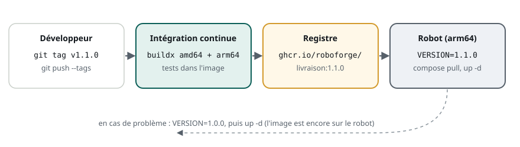

# Du poste de développement au robot

> **La situation.** Le robot de livraison roule avec un ordinateur embarqué ARM (un Jetson ou un Raspberry Pi), alors que l'équipe développe sur des PC. Ce soir, il faut livrer la version 1.1 sur trois robots, sans les démonter, et pouvoir revenir à la 1.0 en une minute si quelque chose se passe mal. Vous allez organiser cette livraison avec ce que vous savez déjà : une image, un registre, un `compose.yaml`.

**Dans ce module, vous allez :**

- construire une image pour **plusieurs architectures** de processeur ;
- **versionner** les images et les publier dans un **registre** ;
- **déployer** une nouvelle version sur le robot et **revenir en arrière** ;
- surveiller le robot : **journaux**, **état de santé**, **espace disque** ;
- connaître les réglages propres à l'embarqué : **GPU**, sécurité.

C'est un module de cours : il se termine par un QCM, et ses commandes sont à refaire chez vous.

## L'essentiel en théorie

- Une image est compilée pour une **architecture** : `amd64` pour un PC, `arm64` pour un Jetson ou un Raspberry Pi. `docker buildx` construit les deux et les publie sous **un même nom**.
- Chaque livraison a un **tag de version** (`1.1.0`) qu'on ne déplace jamais ; on ne déploie pas `latest`.
- Sur le robot, la version à lancer est une **variable** du `compose.yaml` : déployer, c'est `pull` puis `up -d` ; revenir en arrière, c'est remettre l'ancienne valeur.
- Un robot a peu de disque : on **limite la taille des journaux** et on **nettoie** les vieilles images.
- Le moins de droits possible : pas de `privileged`, un utilisateur non `root`, aucun secret dans l'image.

## 1. Une image, plusieurs processeurs



Une image contient des programmes compilés : celle construite sur votre PC (`amd64`) ne démarre pas sur un processeur ARM (`exec format error`). `docker buildx` construit pour plusieurs plateformes et publie une **image multi-architecture** : un seul nom, et chaque machine télécharge automatiquement la variante qui lui correspond.

```text
docker buildx build \
  --platform linux/amd64,linux/arm64 \
  -t ghcr.io/roboforge/livraison:1.1.0 \
  --push .
```

Sur un PC, la variante `arm64` est construite en **émulant** un processeur ARM (QEMU) : cela fonctionne, mais compiler du C++ devient dix fois plus lent, voire davantage. Pour un vrai projet, on construit chaque architecture sur une machine native : un serveur d'intégration continue ARM, ou le robot de développement lui-même.

Les images officielles de ROS 2 (`ros:jazzy-*`) existent déjà pour `amd64` et `arm64` : votre `Dockerfile` n'a rien à changer.

## 2. Versions et registre

L'image est publiée dans un **registre** que les robots peuvent joindre : GitHub Container Registry (`ghcr.io`), Docker Hub, GitLab, ou un registre privé dans l'entreprise.

| Tag | Usage |
|---|---|
| `1.1.0` | une livraison précise, **jamais déplacée** : c'est ce qu'on déploie |
| `1.1` | la dernière correction de la 1.1 (`1.1.0`, puis `1.1.1`…), pratique en test |
| `latest` | la dernière image construite : utile pour essayer, **dangereux sur un robot** |
| `dev-3f9c2e1` | une image construite à partir d'un commit, pour les essais |

Avec `latest`, deux robots qui font `pull` à une heure d'écart peuvent tourner sur deux versions différentes, et personne ne sait laquelle. Avec `1.1.0`, la flotte est dans un état connu.

L'intégration continue fait ce travail : à chaque tag Git `v1.1.0`, elle construit l'image, lance les tests **dans l'image**, puis la publie sous `1.1.0`. Ce qui part sur le robot est exactement ce qui a été testé.

## 3. Déployer et revenir en arrière

Sur le robot, le `compose.yaml` du module précédent lit la version dans une variable :

```yaml
x-ros: &ros
  image: ghcr.io/roboforge/livraison:${VERSION:?indiquez VERSION dans .env}
  network_mode: host
  ipc: host
  restart: unless-stopped
```

Et la version se règle dans le fichier `.env`, à côté du `compose.yaml` :

```text
VERSION=1.1.0
```

Déployer la nouvelle version :

```text
docker compose pull        # télécharge la 1.1.0, pendant que la 1.0.0 tourne encore
docker compose up -d       # recrée les conteneurs dont l'image a changé
docker compose ps          # tout est Up ? les journaux sont propres ?
```

Revenir en arrière : remettre `VERSION=1.0.0` dans `.env`, puis `docker compose up -d`. L'ancienne image est encore sur le robot : le retour ne demande même pas de réseau.

Quelques règles de bon sens, déjà vues au module « De la simulation au robot réel » :

- on met à jour un robot **à l'arrêt**, sur sa base, jamais en mission ;
- on essaie d'abord sur **un** robot, puis sur la flotte ;
- on note quelle version tourne sur quel robot (`docker compose images`).

## 4. Surveiller le robot

**L'état de santé.** Un conteneur « Up » n'est pas forcément un robot qui fonctionne : un nœud peut avoir planté dans un `ros2 launch` qui tourne toujours. Un `healthcheck` vérifie régulièrement ce qui compte vraiment :

```yaml
  robot:
    <<: *ros
    command: ros2 launch livraison_bringup robot.launch.py
    healthcheck:
      test: ["CMD", "/ros_entrypoint.sh", "bash", "-c",
             "timeout 5 ros2 topic echo --once /etat std_msgs/msg/String"]
      interval: 30s
      retries: 3
```

`docker compose ps` affiche alors `healthy` ou `unhealthy`.

**Les journaux.** `docker compose logs` garde tout ce que les nœuds écrivent. Sur un robot qui tourne des semaines, ces journaux peuvent remplir le disque ; on limite leur taille :

```yaml
x-ros: &ros
  logging:
    driver: json-file
    options:
      max-size: "10m"   # 10 Mo par fichier
      max-file: "3"     # 3 fichiers au plus, par conteneur
```

**L'espace disque.** Chaque nouvelle version ajoute des couches. `docker system df` montre la place occupée ; `docker image prune` supprime les images qui ne servent plus. Gardez au moins la version précédente, pour pouvoir revenir en arrière. Les enregistrements `ros2 bag` (dans un volume, module 3) sont souvent ce qui grossit le plus.

## 5. GPU et sécurité

**Le GPU.** Sur un Jetson ou un PC avec carte NVIDIA, la détection d'objets ou le traitement d'image ont besoin du GPU. Avec le *NVIDIA Container Toolkit* installé sur l'hôte, un service le demande ainsi :

```yaml
  perception:
    <<: *ros
    deploy:
      resources:
        reservations:
          devices:
            - driver: nvidia
              count: all
              capabilities: [gpu]
```

Les images de base changent alors : NVIDIA publie des images avec CUDA (et, pour les Jetson, avec les bibliothèques de JetPack) sur lesquelles on installe ROS.

**La sécurité.** Un robot circule au milieu des gens et se connecte au réseau de l'entreprise :

- un utilisateur non `root` dans l'image (`USER`, module 2) ;
- pas de `privileged: true` : seulement les `devices` nécessaires ;
- **aucun secret dans l'image** (mots de passe, clés d'API, jetons du registre) : ils se lisent dans les couches. On les passe au démarrage, par un fichier `.env` qui n'est pas dans Git, ou par les *secrets* de Compose ;
- des images à jour : reconstruire régulièrement récupère les correctifs de sécurité d'Ubuntu et de ROS.

## 6. À refaire chez vous

```text
docker buildx ls                                        # les plateformes disponibles
docker buildx build --platform linux/arm64 -t livraison:arm64 --load .   # l'image ARM, par émulation
docker image inspect livraison:arm64 --format '{{.Architecture}}'       # arm64
docker compose images                                   # quelle image, quelle version, par service
docker system df                                        # la place occupée par Docker
```

## 7. À retenir

| Notion | En une phrase |
|---|---|
| Multi-architecture | `buildx --platform linux/amd64,linux/arm64` : un nom, une variante par processeur |
| Version | on déploie `1.1.0`, jamais `latest` |
| Déployer | `VERSION` dans `.env`, puis `docker compose pull` et `up -d` |
| Revenir en arrière | l'ancienne `VERSION`, puis `up -d` ; l'image est encore sur le robot |
| Santé | un `healthcheck` qui vérifie un topic, pas seulement le conteneur |
| Disque | journaux limités (`max-size`), vieilles images supprimées |
| Sécurité | non `root`, pas `privileged`, aucun secret dans l'image |

**Et maintenant ?** Vous savez livrer un logiciel robotique comme une équipe professionnelle : une image testée, versionnée, déployée et réversible. Le parcours « Tester et fiabiliser un logiciel robotique » construira justement les tests qui tournent dans cette image.
