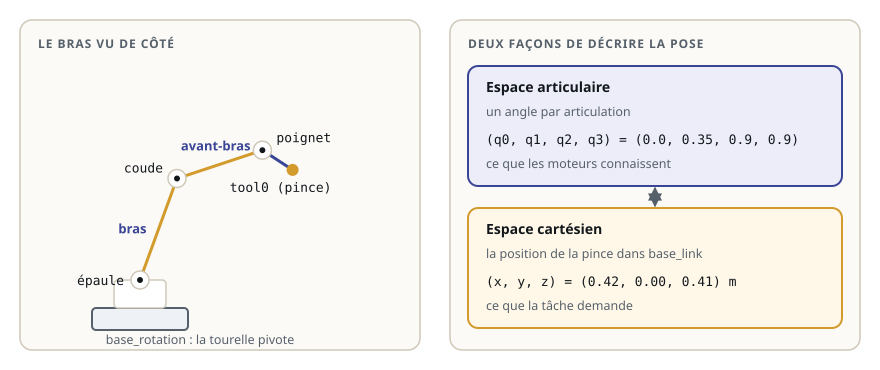

# Le bras manipulateur

> **La situation.** Le centre de tri reçoit un bras robotique : il prend les colis sur un tapis et les dépose dans le bac du robot de livraison. Avant de le programmer, il faut savoir le décrire : de quoi il est fait, comment il bouge, et comment on parle de la position de sa pince.

**Dans ce module, vous allez :**

- nommer les parties d'un bras : articulations, segments, poignet, effecteur ;
- compter ses degrés de liberté et distinguer espace articulaire et espace cartésien ;
- lancer la description du bras de tri et le manipuler dans la Vue 3D du lab ;
- lire la position de la pince avec TF2, pour plusieurs poses.

## L'essentiel en théorie

Un **bras manipulateur** est une chaîne de corps rigides, les **segments**, reliés par des **articulations** motorisées. Le premier segment est fixé au sol ou à une table (le **socle**) ; le dernier porte l'**effecteur**, l'outil qui agit sur le monde : une pince, une ventouse, une torche de soudage.



### Deux sortes d'articulations

| Articulation | Mouvement | Joint URDF | Dans le bras de tri |
|---|---|---|---|
| **rotoïde** | rotation autour d'un axe, entre deux butées | `revolute` | tourelle, épaule, coude, poignet |
| **prismatique** | translation le long d'un axe | `prismatic` | l'ouverture de la pince |

Ce sont les types de joints du module URDF : un bras se décrit exactement comme le robot mobile, avec des links et des joints.

### Degrés de liberté

Chaque articulation motorisée ajoute un **degré de liberté** (ddl). Le bras de tri en a quatre pour placer la pince, plus un pour l'ouvrir :

- `base_rotation` : la tourelle pivote autour de la verticale ;
- `epaule`, `coude`, `poignet` : trois rotations parallèles, qui travaillent dans le plan vertical de la tourelle.

Placer un objet n'importe où et dans n'importe quelle orientation demande **six** degrés de liberté (trois pour la position, trois pour l'orientation) : c'est pourquoi les bras industriels ont six axes. Le bras de tri, avec quatre, peut atteindre un point avec la pince tournée vers le bas : c'est tout ce que demande la prise d'un colis posé sur un tapis.

### Espace articulaire, espace cartésien

La même pose du bras se décrit de deux façons :

- dans l'**espace articulaire** : un angle par articulation, `(q0, q1, q2, q3)`. C'est ce que mesurent les codeurs et ce que commandent les moteurs ;
- dans l'**espace cartésien** : la position (et l'orientation) de l'effecteur dans le repère du socle, `(x, y, z)`. C'est ce que demande la tâche : « prends le colis en (0,30 ; 0,10 ; 0,15) ».

Passer de l'un à l'autre est le cœur du parcours :

- **cinématique directe** : des angles vers la position de la pince. Un seul résultat, toujours calculable (module 32) ;
- **cinématique inverse** : d'une position voulue vers les angles. Zéro, une ou plusieurs solutions (module 33).

### Espace de travail et limites

L'**espace de travail** est l'ensemble des points que l'effecteur peut atteindre. Il dépend de la longueur des segments (le bras de tri tendu atteint 0,65 m depuis l'épaule) et des **limites articulaires** : chaque articulation a des butées (`<limit lower upper>` dans l'URDF), pour ne pas heurter le socle ou ses propres segments.

### Le point de l'outil

On ne s'intéresse pas à la position du poignet mais à celle du point où l'outil agit : entre les doigts de la pince. Par convention, ce repère s'appelle `tool0` ; c'est un link sans géométrie, attaché au dernier segment par un joint fixe. Toute la suite du parcours parle de la position de `tool0` dans `base_link`.

## 1. Le bras de tri

Le workspace du module, `~/ws/30-bras-manipulateur`, contient déjà la description du bras, le package `bras_description` :

```text
bras_description/
├── CMakeLists.txt          installe urdf/ et launch/
├── package.xml
├── launch/display.launch.py
└── urdf/bras.urdf.xacro    le socle, la tourelle, trois segments, la pince, tool0
```

Ouvrez `urdf/bras.urdf.xacro` dans l'éditeur. Repérez :

- les **propriétés** en tête de fichier : hauteur de l'épaule `h_epaule`, longueurs `l_bras`, `l_avant_bras` et `l_poignet` ;
- le joint `base_rotation`, d'axe `0 0 1` (la verticale) ;
- la macro `segment`, utilisée trois fois : une articulation d'axe `0 1 0`, puis une barre dans le prolongement ;
- la pince : deux joints prismatiques, le second avec une balise `<mimic joint="pince"/>` : il imite le premier, les deux doigts s'écartent ensemble ;
- `tool0`, au bout du poignet.

Tous les angles à 0, le bras est tendu vers le haut ; un angle positif le penche vers l'avant (l'axe `x` de la tourelle).

## 2. Lancer et regarder le bras

Compilez le workspace et lancez la description :

```bash
cd ~/ws/30-bras-manipulateur
colcon build --symlink-install
source install/setup.bash
ros2 launch bras_description display.launch.py
```

Le fichier de lancement démarre `robot_state_publisher`, qui publie la description et les TF, et `joint_state_publisher`, qui publie tous les angles à 0.

Cliquez sur **Vue 3D** dans la barre du haut. Le bras apparaît, avec un trièdre par link. Dans la liste **Articulations**, il y a un curseur par joint mobile : `base_rotation`, `epaule`, `coude`, `poignet` et `pince`. Le second doigt n'a pas de curseur : il imite `pince`.

Faites bouger chaque curseur :

- `base_rotation` fait tourner tout le bras autour de la verticale ;
- `epaule`, `coude` et `poignet` le plient dans un plan vertical, celui de la tourelle ;
- `pince` écarte les deux doigts.

Notez les butées : le coude ne dépasse pas ±2,2 rad (126°), sinon l'avant-bras rentrerait dans le bras.

## 3. Lire la position de la pince

Dans un deuxième terminal, demandez à TF2 où se trouve `tool0` :

```bash
ros2 run tf2_ros tf2_echo base_link tool0
```

Tous les angles à 0, la pince est à la verticale du socle :

```text
- Translation: [0.000, 0.000, 0.750]
```

0,75 m, c'est la hauteur de l'épaule (0,10 m) plus le bras (0,30 m), l'avant-bras (0,25 m) et le poignet jusqu'au point de prise (0,10 m).

Les curseurs de la Vue 3D ne bougent que le dessin. Pour que `robot_state_publisher` calcule les TF d'une autre pose, il faut publier l'état des joints. Arrêtez le lancement (Ctrl+C) et relancez-le **sans** `joint_state_publisher` :

```bash
ros2 launch bras_description display.launch.py jsp:=false
```

Dans la Vue 3D, cochez **Publier sur /joint_states** : les curseurs publient maintenant l'état des joints, comme `joint_state_publisher_gui`. Placez l'épaule à 1,57 rad (90°), les autres à 0 : le bras est horizontal. `tf2_echo` affiche alors environ `[0.650, 0.000, 0.100]` : la pince est à 0,65 m devant l'épaule, à la hauteur de l'épaule.

Essayez d'autres poses et observez :

- la tourelle seule (`base_rotation`) ne change ni la hauteur `z` ni la distance à l'axe : elle fait tourner le point autour de la verticale ;
- plusieurs poses différentes amènent la pince au même point : coude vers le haut ou vers le bas, par exemple. C'est ce qui rendra la cinématique inverse intéressante.

Vous pouvez aussi publier un état sans la Vue 3D, depuis un terminal :

```bash
ros2 topic pub -r 10 /joint_states sensor_msgs/msg/JointState \
  "{name: [base_rotation, epaule, coude, poignet, pince], position: [0.0, 1.57, 0.0, 0.0, 0.0]}"
```

## 4. Rappel

- Un bras est une chaîne de segments et d'articulations ; il se décrit en URDF comme n'importe quel robot ;
- chaque articulation motorisée est un degré de liberté ; six suffisent pour une position et une orientation quelconques ;
- la même pose s'écrit en angles (espace articulaire) ou en position de l'outil (espace cartésien) ;
- `tool0` est le repère du point de prise, et TF2 donne sa position dans `base_link`.

**Et maintenant ?** Le module suivant écrit cette description vous-même, et montre ce qui se passe quand un axe d'articulation est faux.
