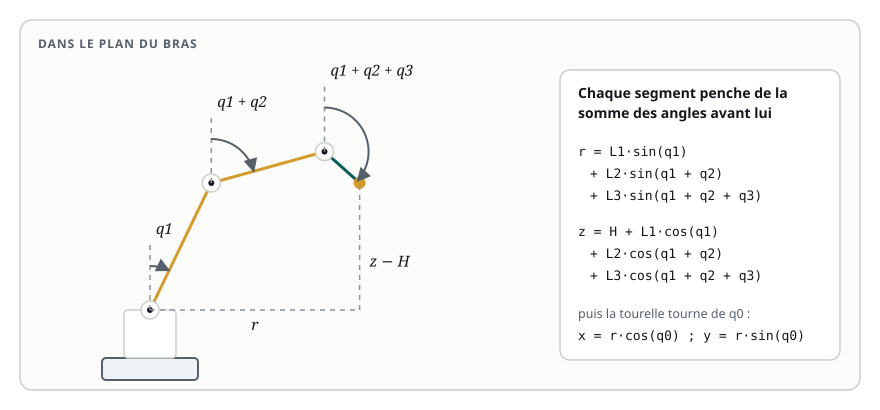

# Cinématique directe

> **La situation.** Le superviseur du centre de tri veut savoir en permanence où est la pince, sans dépendre de TF2 : pour journaliser les prises, et bientôt pour vérifier qu'une commande ne fera pas sortir la pince de sa zone. Vous allez écrire le calcul, la **cinématique directe**, et le publier dans un nœud ROS 2.

**Dans ce module, vous allez :**

- établir la formule de la position de la pince à partir des quatre angles ;
- l'écrire en Python, dans une fonction testable sans ROS ;
- la publier depuis un nœud qui écoute `/joint_states` ;
- la comparer à la position que TF2 déduit de l'URDF.

## L'essentiel en théorie

La **cinématique directe** répond à la question : les articulations étant à ces angles, où est l'effecteur ? Elle a toujours une réponse, et une seule. `robot_state_publisher` la calcule pour tous les links, à partir de l'URDF, en enchaînant les transformations de chaque joint ; pour notre bras, une formule de quelques lignes suffit, et elle se comprend.

### Le bras dans son plan

La tourelle tourne de `q0` autour de la verticale ; l'épaule, le coude et le poignet ont des axes parallèles et plient le bras dans un plan vertical. On calcule donc en deux temps :

1. **dans le plan du bras** : la distance horizontale `r` de la pince à l'axe de la tourelle, et sa hauteur `z` ;
2. **autour de la verticale** : la tourelle fait tourner ce plan de `q0`, ce qui donne `x` et `y`.

### Des angles qui se cumulent

Chaque angle se mesure depuis la verticale, **par rapport au segment précédent**. Le bras penche de `q1` ; l'avant-bras, porté par le bras, penche de `q1 + q2` ; la pince de `q1 + q2 + q3`. Chaque segment de longueur `L`, incliné de `φ`, avance de `L·sin(φ)` à l'horizontale et monte de `L·cos(φ)` :



```text
r = L1·sin(q1) + L2·sin(q1 + q2) + L3·sin(q1 + q2 + q3)
z = H + L1·cos(q1) + L2·cos(q1 + q2) + L3·cos(q1 + q2 + q3)
x = r·cos(q0)
y = r·sin(q0)
```

avec `H = 0,10` m (hauteur de l'épaule), `L1 = 0,30` m (bras), `L2 = 0,25` m (avant-bras), `L3 = 0,10` m (du poignet au point de prise).

Deux vérifications de bon sens, à faire à chaque formule :

- **tous les angles à 0** : `r = 0` et `z = 0,10 + 0,30 + 0,25 + 0,10 = 0,75` m, le bras tendu vers le haut ;
- **épaule à 90°**, le reste à 0 : `r = 0,65` m et `z = 0,10` m, le bras horizontal à hauteur de l'épaule.

### Et pour un bras quelconque ?

Un bras à six axes n'a pas d'articulations parallèles : on enchaîne des **matrices de transformation homogène** 4×4, une par joint (la translation de l'`origin`, puis la rotation autour de l'`axis`). C'est exactement ce que fait `robot_state_publisher`, et la convention de **Denavit-Hartenberg** est une façon standard de les écrire. Le principe reste celui de ce module : chaque articulation transforme tout ce qu'elle porte.

## 1. Le package `bras_controle`

Le workspace du module, `~/ws/32-cinematique-directe`, contient la description du bras et un nouveau package Python, `bras_controle`. Le calcul est séparé du nœud : une fonction pure, sans ROS, qu'on peut tester et réutiliser (le module suivant s'en sert).

```python fichier=src/bras_controle/bras_controle/cinematique.py
"""Cinématique du bras de tri : les mêmes dimensions que bras.urdf.xacro.

Les angles se mesurent depuis la verticale ; un angle positif penche le bras vers l'avant.
"""
import math

H = 0.10   # hauteur de l'épaule au-dessus du socle (m)
L1 = 0.30  # bras : épaule → coude
L2 = 0.25  # avant-bras : coude → poignet
L3 = 0.10  # poignet → point de prise (tool0)

ARTICULATIONS = ('base_rotation', 'epaule', 'coude', 'poignet')


def position_pince(q0, q1, q2, q3):
    """Cinématique directe : position de tool0 dans base_link, à partir des quatre angles."""
    # chaque segment s'ajoute avec l'angle cumulé de toutes les articulations avant lui
    r = L1 * math.sin(q1) + L2 * math.sin(q1 + q2) + L3 * math.sin(q1 + q2 + q3)
    z = H + L1 * math.cos(q1) + L2 * math.cos(q1 + q2) + L3 * math.cos(q1 + q2 + q3)
    return r * math.cos(q0), r * math.sin(q0), z
```

Essayez-la directement, sans ROS :

```bash
cd ~/ws/32-cinematique-directe/src/bras_controle
python3 -c "from bras_controle.cinematique import position_pince; print(position_pince(0, 0, 0, 0)); print(position_pince(0, 1.5708, 0, 0))"
```

Vous devez retrouver `(0.0, 0.0, 0.75)` et environ `(0.65, 0.0, 0.10)`.

## 2. Le nœud

Le nœud écoute `/joint_states`, retrouve les quatre angles par leur nom (l'ordre des joints dans le message n'est pas garanti) et publie la position de la pince sur `/position_pince`, un `geometry_msgs/PointStamped` dans le repère `base_link` :

```python fichier=src/bras_controle/bras_controle/cinematique_directe.py
"""Publie la position de la pince calculée à partir de l'état des articulations."""
import rclpy
from geometry_msgs.msg import PointStamped
from rclpy.node import Node
from sensor_msgs.msg import JointState

from bras_controle.cinematique import ARTICULATIONS, position_pince


class CinematiqueDirecte(Node):
    def __init__(self):
        super().__init__('cinematique_directe')
        self.pub = self.create_publisher(PointStamped, 'position_pince', 10)
        self.create_subscription(JointState, 'joint_states', self.recevoir, 10)

    def recevoir(self, msg):
        angles = dict(zip(msg.name, msg.position))
        if not all(nom in angles for nom in ARTICULATIONS):
            return  # un état partiel (la pince seule, par exemple)
        x, y, z = position_pince(*(angles[nom] for nom in ARTICULATIONS))
        point = PointStamped()
        point.header.stamp = msg.header.stamp
        point.header.frame_id = 'base_link'
        point.point.x, point.point.y, point.point.z = x, y, z
        self.pub.publish(point)


def main():
    rclpy.init()
    node = CinematiqueDirecte()
    try:
        rclpy.spin(node)
    except KeyboardInterrupt:
        pass
    finally:
        node.destroy_node()
        rclpy.try_shutdown()
```

Il reprend l'horodatage de l'état des joints : la position publiée correspond à cet instant-là.

## 3. Comparer à TF2

Compilez et lancez la description du bras **sans** `joint_state_publisher` :

```bash
cd ~/ws/32-cinematique-directe
colcon build --symlink-install
source install/setup.bash
ros2 launch bras_description display.launch.py jsp:=false
```

Dans un deuxième terminal, le nœud de cinématique directe :

```bash
ros2 run bras_controle cinematique_directe
```

Dans un troisième, ouvrez la **Vue 3D**, cochez **Publier sur /joint_states** et placez le bras dans une pose quelconque. Puis comparez les deux calculs :

```bash
ros2 topic echo --once /position_pince
ros2 run tf2_ros tf2_echo base_link tool0
```

`/position_pince` vient de votre formule, `tf2_echo` des transformations de l'URDF : les deux doivent coïncider au millimètre. S'ils divergent, l'un des deux est faux : la formule, ou la description (un axe, une longueur).

## 4. Rappel

- La cinématique directe donne la position de l'effecteur à partir des angles, avec une seule réponse ;
- pour un bras plan : chaque segment s'incline de la **somme** des angles qui le précèdent ;
- séparez le calcul (fonction pure) du nœud : il se teste sans ROS ;
- TF2 fait le même calcul à partir de l'URDF : comparer les deux valide l'un par l'autre.

**Et maintenant ?** L'exercice part d'une formule qui oublie de cumuler les angles. Ensuite, le module 33 fait le chemin inverse : trouver les angles qui amènent la pince sur un colis.
