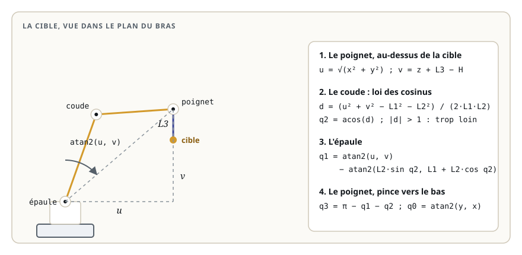

# Cinématique inverse

> **La situation.** La caméra du centre de tri repère un colis sur le tapis et publie sa position sur `/cible`. Le bras doit y amener sa pince, tournée vers le bas pour le saisir. Il faut donc faire le chemin inverse du module précédent : de la position voulue vers les angles des articulations.

**Dans ce module, vous allez :**

- comprendre pourquoi la cinématique inverse peut avoir zéro, une ou plusieurs solutions ;
- la résoudre pour le bras de tri, par la géométrie : un triangle et la loi des cosinus ;
- écrire un nœud qui amène la pince sur chaque cible reçue ;
- refuser une cible hors d'atteinte ou hors des butées, au lieu d'envoyer le bras n'importe où.

## L'essentiel en théorie

La **cinématique inverse** répond à la question : quels angles placent l'effecteur à cette position ? Contrairement à la directe, la réponse n'est pas toujours unique :

- **aucune solution** : la cible est trop loin, ou trop près du socle, ou n'est atteignable qu'en dépassant une butée ;
- **plusieurs solutions** : le coude peut être « en haut » ou « en bas » pour amener le poignet au même point ; un bras à six axes en a jusqu'à huit ;
- **une infinité** : un bras qui a plus d'articulations que la tâche n'en demande (redondant) peut bouger sans déplacer la pince.

Il faut donc **choisir** une solution, et savoir dire non.

### Fixer ce qui reste libre

Le bras de tri a quatre articulations, et une position `(x, y, z)` n'impose que trois valeurs : il reste un choix. On le fixe avec la tâche : pour saisir un colis par le dessus, **la pince pointe vers le bas**. La somme des trois angles du plan vaut alors π (le bras tendu vers le haut, retourné) :

```text
q1 + q2 + q3 = π
```

### La méthode géométrique



1. **La tourelle** s'oriente vers la cible : `q0 = atan2(y, x)`.
2. **Le poignet**, puisque la pince pointe vers le bas, est à `L3` au-dessus de la cible. Dans le plan du bras, il est à une distance horizontale `u = √(x² + y²)` et à une hauteur `v = z + L3 − H` de l'épaule.
3. **Le coude** : le bras (`L1`), l'avant-bras (`L2`) et la droite épaule-poignet forment un triangle dont on connaît les trois côtés. La loi des cosinus donne l'angle du coude :

   ```text
   d  = (u² + v² − L1² − L2²) / (2·L1·L2)
   q2 = acos(d)
   ```

   Si `|d| > 1`, le triangle n'existe pas : la cible est hors d'atteinte. `acos` donne la solution « coude vers l'avant » ; `−acos(d)` donnerait l'autre.
4. **L'épaule** vise le poignet, corrigée de l'angle que fait le bras avec la droite épaule-poignet :

   ```text
   q1 = atan2(u, v) − atan2(L2·sin(q2), L1 + L2·cos(q2))
   ```

   Nos angles se mesurent depuis la **verticale** : `atan2(u, v)` est l'angle entre la verticale et la direction du poignet.
5. **Le poignet** compense, pour que la pince pointe vers le bas : `q3 = π − q1 − q2`.

Enfin, on vérifie chaque angle contre les **butées** de l'URDF : une solution mathématique qui demande au coude 2,3 rad n'est pas une solution.

### Vérifier avec la cinématique directe

Le meilleur test d'une cinématique inverse est la directe : `position_pince(*angles_pour(x, y, z))` doit redonner `(x, y, z)`. C'est rapide, sans ROS, et ça attrape la plupart des erreurs de signe ou d'argument.

### Et pour un bras quelconque ?

La méthode géométrique marche pour les bras dont la structure s'y prête (articulations parallèles, poignet dont les axes se croisent). Sinon, on utilise des **solveurs numériques** qui partent d'une estimation et la corrigent pas à pas avec la jacobienne : KDL, TRAC-IK ou ceux de MoveIt. Ils ont les mêmes questions à trancher : quelle solution choisir, que faire hors d'atteinte.

## 1. La fonction `angles_pour`

Le workspace du module, `~/ws/33-cinematique-inverse`, reprend les packages du module précédent. `cinematique.py` s'enrichit des butées des articulations et de la cinématique inverse :

```python fichier=src/bras_controle/bras_controle/cinematique.py
"""Cinématique du bras de tri : les mêmes dimensions que bras.urdf.xacro.

Les angles se mesurent depuis la verticale ; un angle positif penche le bras vers l'avant.
"""
import math

H = 0.10   # hauteur de l'épaule au-dessus du socle (m)
L1 = 0.30  # bras : épaule → coude
L2 = 0.25  # avant-bras : coude → poignet
L3 = 0.10  # poignet → point de prise (tool0)

ARTICULATIONS = ('base_rotation', 'epaule', 'coude', 'poignet')
LIMITES = {'epaule': 1.6, 'coude': 2.2, 'poignet': 1.8}


def position_pince(q0, q1, q2, q3):
    """Cinématique directe : position de tool0 dans base_link, à partir des quatre angles."""
    # chaque segment s'ajoute avec l'angle cumulé de toutes les articulations avant lui
    r = L1 * math.sin(q1) + L2 * math.sin(q1 + q2) + L3 * math.sin(q1 + q2 + q3)
    z = H + L1 * math.cos(q1) + L2 * math.cos(q1 + q2) + L3 * math.cos(q1 + q2 + q3)
    return r * math.cos(q0), r * math.sin(q0), z


def angles_pour(x, y, z):
    """Cinématique inverse : les quatre angles qui amènent tool0 en (x, y, z), pince vers le bas.

    Lève ValueError si la cible est hors d'atteinte ou hors des limites des articulations.
    """
    q0 = math.atan2(y, x)
    # la pince pointe vers le bas : le poignet est à L3 au-dessus de la cible, dans le plan du bras
    u = math.hypot(x, y)   # distance horizontale depuis l'axe de la tourelle
    v = z + L3 - H         # hauteur du poignet au-dessus de l'épaule
    d = (u * u + v * v - L1 * L1 - L2 * L2) / (2 * L1 * L2)
    if abs(d) > 1:
        raise ValueError(f'cible hors d\'atteinte : le poignet serait à {math.hypot(u, v):.2f} m de l\'épaule')
    q2 = math.acos(d)  # coude plié vers l'avant
    q1 = math.atan2(u, v) - math.atan2(L2 * math.sin(q2), L1 + L2 * math.cos(q2))
    q3 = math.pi - q1 - q2  # la somme des trois angles vaut π : la pince pointe vers le bas
    for nom, angle in zip(('epaule', 'coude', 'poignet'), (q1, q2, q3)):
        if abs(angle) > LIMITES[nom]:
            raise ValueError(f'{nom} hors limites : {angle:.2f} rad (±{LIMITES[nom]})')
    return q0, q1, q2, q3
```

Vérifiez-la par la directe, sans ROS :

```bash
cd ~/ws/33-cinematique-inverse/src/bras_controle
python3 -c "
from bras_controle.cinematique import angles_pour, position_pince
angles = angles_pour(0.30, 0.10, 0.15)
print([round(a, 3) for a in angles])
print([round(v, 3) for v in position_pince(*angles)])"
```

Vous devez obtenir les angles `[0.322, 0.353, 1.772, 1.017]`, et la directe redonne bien `[0.3, 0.1, 0.15]`.

## 2. Le nœud

Le nœud écoute `/cible`, calcule les angles et publie l'état des joints sur `/joint_states`, en continu, pour que `robot_state_publisher` garde des TF à jour. Une cible refusée est signalée dans le journal, et le bras reste où il est :

```python fichier=src/bras_controle/bras_controle/cinematique_inverse.py
"""Amène la pince sur la cible reçue sur /cible : calcule les angles et publie /joint_states."""
import rclpy
from geometry_msgs.msg import PointStamped
from rclpy.node import Node
from sensor_msgs.msg import JointState

from bras_controle.cinematique import ARTICULATIONS, angles_pour


class CinematiqueInverse(Node):
    def __init__(self):
        super().__init__('cinematique_inverse')
        self.angles = [0.0, 0.0, 0.0, 0.0]  # bras tendu vers le haut au départ
        self.pub = self.create_publisher(JointState, 'joint_states', 10)
        self.create_subscription(PointStamped, 'cible', self.viser, 10)
        # l'état est republié en continu : robot_state_publisher garde des TF à jour
        self.create_timer(0.05, self.publier)

    def viser(self, msg):
        p = msg.point
        try:
            self.angles = list(angles_pour(p.x, p.y, p.z))
        except ValueError as exc:
            self.get_logger().warning(f'cible ({p.x:.2f}, {p.y:.2f}, {p.z:.2f}) ignorée : {exc}')
            return
        self.get_logger().info(f'cible ({p.x:.2f}, {p.y:.2f}, {p.z:.2f}) : angles '
                               + ', '.join(f'{a:.2f}' for a in self.angles))

    def publier(self):
        msg = JointState()
        msg.header.stamp = self.get_clock().now().to_msg()
        msg.name = [*ARTICULATIONS, 'pince']
        msg.position = [*self.angles, 0.0]
        self.pub.publish(msg)


def main():
    rclpy.init()
    node = CinematiqueInverse()
    try:
        rclpy.spin(node)
    except KeyboardInterrupt:
        pass
    finally:
        node.destroy_node()
        rclpy.try_shutdown()
```

Déclarez-le dans `setup.py`, à côté du nœud de cinématique directe :

```python fichier=src/bras_controle/setup.py
from setuptools import find_packages, setup

package_name = 'bras_controle'

setup(
    name=package_name,
    version='0.1.0',
    packages=find_packages(exclude=['test']),
    data_files=[
        ('share/ament_index/resource_index/packages', ['resource/' + package_name]),
        ('share/' + package_name, ['package.xml']),
    ],
    install_requires=['setuptools'],
    zip_safe=True,
    maintainer='etudiant',
    maintainer_email='etudiant@roboforge.example',
    description='Cinématique du bras de tri du parcours « Programmer un bras robotique avec ROS 2 »',
    license='Apache-2.0',
    entry_points={
        'console_scripts': [
            'cinematique_directe = bras_controle.cinematique_directe:main',
            'cinematique_inverse = bras_controle.cinematique_inverse:main',
        ],
    },
)
```

## 3. Amener la pince sur un colis

Compilez et lancez la description **sans** `joint_state_publisher` : c'est la cinématique inverse qui publie l'état des joints.

```bash
cd ~/ws/33-cinematique-inverse
colcon build --symlink-install
source install/setup.bash
ros2 launch bras_description display.launch.py jsp:=false
```

Dans un deuxième terminal, le nœud :

```bash
ros2 run bras_controle cinematique_inverse
```

Ouvrez la **Vue 3D** (sans cocher **Publier sur /joint_states**), puis, dans un troisième terminal, envoyez une cible :

```bash
ros2 topic pub --once /cible geometry_msgs/msg/PointStamped \
  "{header: {frame_id: base_link}, point: {x: 0.30, y: 0.10, z: 0.15}}"
```

Le bras pivote et descend, pince vers le bas. Vérifiez où est la pince :

```bash
ros2 run tf2_ros tf2_echo base_link tool0
```

`tf2_echo` affiche `[0.300, 0.100, 0.150]` : la position calculée par TF2 à partir de l'URDF est bien la cible.

Essayez d'autres cibles, et observez le journal du nœud :

- `(0.20, -0.20, 0.20)` : la tourelle tourne de l'autre côté ;
- `(0.80, 0.00, 0.20)` : « cible hors d'atteinte », le bras ne bouge pas ;
- `(0.15, 0.15, 0.10)` : trop près du socle, « coude hors limites ».

Vous remarquerez que le bras **saute** d'une pose à l'autre : le nœud publie directement les angles finaux. Un vrai bras doit suivre une trajectoire, avec des vitesses et des accélérations limitées : c'est la suite du parcours.

## 4. Rappel

- La cinématique inverse peut avoir zéro, une ou plusieurs solutions : il faut en choisir une et savoir refuser ;
- fixez ce que la tâche impose (ici, la pince vers le bas) pour lever les ambiguïtés ;
- méthode géométrique : le point du poignet, la loi des cosinus pour le coude, `atan2` pour l'épaule et la tourelle ;
- vérifiez toujours les butées, et testez l'inverse par la directe.

**Et maintenant ?** L'exercice part d'une cinématique inverse où la pince manque le colis : à vous de trouver pourquoi.
