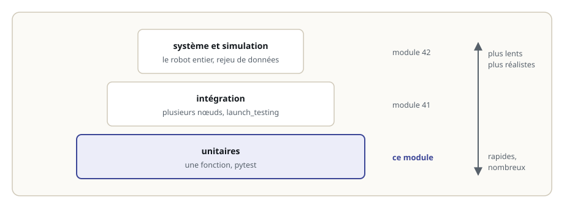
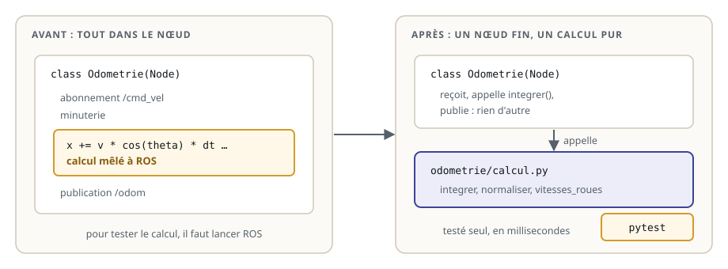
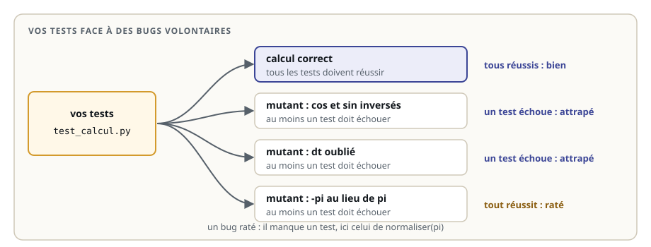

# Tester son code avec pytest

> **La situation.** Le robot de livraison calcule sa position à partir de ses vitesses : c'est l'odométrie. Un collègue a « simplifié » le calcul de l'angle ; deux jours plus tard, le robot tourne en rond dans l'entrepôt, et personne ne sait depuis quand. Un **test** aurait signalé le problème en une seconde, avant même que le code arrive sur le robot. Dans ce module, vous apprenez à écrire ces tests, et surtout des tests qui **attrapent les bugs**.

**Dans ce module, vous allez :**

- comprendre pourquoi on teste le logiciel d'un robot, et ce qu'est un test unitaire ;
- séparer le calcul du nœud ROS pour pouvoir le tester sans lancer ROS ;
- écrire des tests avec **pytest** : cas nominaux, cas limites, tests paramétrés ;
- lancer les tests d'un package avec **colcon test** ;
- mesurer la qualité de vos tests avec des **mutants**, des versions volontairement buggées du code.

## L'essentiel en théorie

- Un **test unitaire** vérifie une petite unité de code, souvent une fonction, isolée du reste : il est rapide et précis.
- Pour qu'un calcul soit testable, on le **sépare** du nœud ROS : une fonction pure, sans abonnement ni publication.
- Un test **prépare** des données, **appelle** la fonction, puis **vérifie** le résultat avec `assert`. Pour les nombres à virgule, on compare avec `pytest.approx`.
- On teste le **cas nominal**, mais surtout les **cas limites** : zéro, valeurs négatives, angles autour de pi.
- Un test qui ne peut jamais échouer ne sert à rien. Un bon test **échoue** quand le code est faux : les **mutants** le vérifient.

## 1. Pourquoi tester un robot

Sur un robot, un bug coûte cher : une collision, une batterie vide, une journée de recherche. Les tests apportent trois choses :

- ils **trouvent les bugs tôt**, sur votre poste, avant le robot ;
- ils **empêchent les régressions** : une fonction qui marchait ne casse pas en silence quand quelqu'un la modifie ;
- ils **documentent** le comportement attendu : un test dit, avec un exemple, ce que la fonction doit faire.

Il y a plusieurs étages de tests. Ce parcours les monte un par un :



Les tests unitaires sont la base : nombreux, rapides, lancés à chaque modification.

## 2. Séparer le calcul du nœud

Un calcul écrit directement dans le nœud ROS, au milieu des abonnements et des publications, ne se teste qu'en lançant ROS. La solution est de le **sortir** dans un module Python ordinaire, que le nœud appelle :



Voici le module de calcul du robot de livraison. Il ne contient aucune ligne de ROS :

```python fichier=src/odometrie/odometrie/calcul.py
"""Calculs du robot de livraison, sans ROS : testables en quelques millisecondes."""

import math


def normaliser(angle):
    """Ramène un angle (rad) dans l'intervalle ]-pi, pi]."""
    angle = math.fmod(angle + math.pi, 2 * math.pi)
    if angle <= 0:
        angle += 2 * math.pi
    return angle - math.pi


def integrer(pose, v, w, dt):
    """Pose (x, y, theta) après dt secondes à la vitesse linéaire v (m/s) et angulaire w (rad/s).

    Méthode d'Euler : x et y avancent selon l'orientation de départ, theta est normalisé.
    """
    x, y, theta = pose
    x += v * math.cos(theta) * dt
    y += v * math.sin(theta) * dt
    theta = normaliser(theta + w * dt)
    return (x, y, theta)


def vitesses_roues(v, w, entraxe):
    """Vitesses linéaires (m/s) des roues gauche et droite d'un robot à conduite différentielle."""
    return (v - w * entraxe / 2, v + w * entraxe / 2)
```

Le nœud, lui, se contente de recevoir les vitesses, d'appeler `integrer()` à chaque pas de temps et de publier la pose : il n'y a presque plus rien à y tester. Les formules sont celles du module 1 sur le robot mobile.

## 3. Un premier test

Avec pytest, un test est une fonction dont le nom commence par `test_`, rangée dans un fichier `test_*.py`. Elle suit toujours le même schéma : **préparer**, **appeler**, **vérifier**.

```python
from odometrie.calcul import integrer


def test_tout_droit_selon_x():
    pose = (0.0, 0.0, 0.0)                      # préparer : à l'origine, face à x
    nouvelle = integrer(pose, 1.0, 0.0, 2.0)    # appeler : 1 m/s pendant 2 s, sans tourner
    assert nouvelle == (2.0, 0.0, 0.0)          # vérifier : 2 m plus loin sur x
```

Ce test passe. Écrit de la même façon pour un robot face à y (`theta = pi / 2`), il échouerait pourtant, à cause d'une subtilité : les calculs en virgule flottante ne sont pas exacts. `math.cos(math.pi / 2)` vaut `6.1e-17`, pas `0`. On compare donc avec une tolérance, grâce à `pytest.approx` :

```python
import pytest

assert integrer((0.0, 0.0, math.pi / 2), 1.0, 0.0, 2.0) == pytest.approx((0.0, 2.0, math.pi / 2))
```

Quand un test échoue, pytest affiche la valeur obtenue et la valeur attendue : c'est souvent assez pour trouver le bug.

## 4. Les cas à tester

Un seul test sur le cas « tout droit » laisse passer beaucoup de bugs. Pour chaque fonction, demandez-vous :

- **le cas nominal** : un mouvement ordinaire donne-t-il le bon résultat ?
- **chaque paramètre compte-t-il ?** Un test où `dt` vaut 2 vérifie qu'on n'a pas oublié `dt` ; avec `dt = 1`, l'oubli passerait inaperçu.
- **les limites** : zéro, valeurs négatives, et pour un angle, la frontière entre `pi` et `-pi` ;
- **les symétries** : gauche et droite, avant et arrière.

Pour tester plusieurs valeurs avec le même test, pytest propose `parametrize` : une ligne par cas.

```python fichier=src/odometrie/test/test_calcul.py
import math

import pytest

from odometrie.calcul import integrer, normaliser, vitesses_roues


def test_immobile():
    assert integrer((1.0, 2.0, 0.5), 0.0, 0.0, 0.1) == (1.0, 2.0, 0.5)


def test_tout_droit_selon_x():
    assert integrer((0.0, 0.0, 0.0), 1.0, 0.0, 2.0) == pytest.approx((2.0, 0.0, 0.0))


@pytest.mark.parametrize("angle, attendu", [(0.0, 0.0), (4.0, 4.0 - 2 * math.pi), (-4.0, 2 * math.pi - 4.0)])
def test_normaliser(angle, attendu):
    assert normaliser(angle) == pytest.approx(attendu)


def test_vitesses_roues_tout_droit():
    assert vitesses_roues(0.3, 0.0, 0.5) == pytest.approx((0.3, 0.3))
```

Ces tests sont un début. Ils laissent encore passer certains bugs : l'exercice vous demande de les trouver.

## 5. Lancer les tests

Dans un package ROS 2 Python, les tests vivent dans le dossier `test/` du package, et le `package.xml` déclare la dépendance de test :

```xml
<test_depend>python3-pytest</test_depend>
```

Deux façons de les lancer :

```bash
cd ~/ws/40-tests-unitaires
cd src/odometrie && python3 -m pytest test   # depuis le package : le plus rapide pendant le développement
cd ~/ws/40-tests-unitaires
colcon build
colcon test --packages-select odometrie      # comme l'intégration continue : tous les tests du package
colcon test-result --verbose                 # le détail des tests échoués
```

`colcon test` lance aussi les tests de qualité du code (style, licences) quand le package les déclare. C'est cette commande qu'exécute l'intégration continue à chaque pull request, comme vous l'avez vu dans le module Git.

## 6. Des tests qui attrapent les bugs

Des tests qui passent ne prouvent rien s'ils ne peuvent pas échouer. Pour mesurer vos tests, on fabrique des **mutants** : des copies du code avec un bug volontaire, comme `cos` et `sin` inversés ou `dt` oublié. On lance vos tests sur chaque mutant : au moins un test doit échouer. Sinon, le bug passerait inaperçu.



Un mutant qui survit vous dit précisément quel test écrire. C'est ce que fait la vérification de l'exercice. Des outils comme `mutmut` automatisent cette technique sur de vrais projets.

## 7. Les bons réflexes

- un test **rapide** et **indépendant** des autres : il ne dépend ni de l'ordre, ni du réseau, ni d'un robot ;
- un **nom qui dit ce qui est vérifié** : `test_rotation_sur_place_tient_compte_de_dt` vaut mieux que `test_2` ;
- un bug trouvé ? Écrivez d'abord le test qui le montre, vérifiez qu'il échoue, puis corrigez : le bug ne reviendra pas ;
- des valeurs choisies pour **distinguer** : `dt = 2` plutôt que `1`, un angle proche de `pi` plutôt que `0` ;
- `pytest.approx` pour comparer des nombres à virgule.

## À vous de jouer

Dans l'exercice, le calcul est correct, mais la suite de tests ne vérifie presque rien. Écrivez des tests qui passent sur le calcul correct et qui attrapent six versions buggées. La vérification vous dit lesquelles passent encore à travers vos tests.
