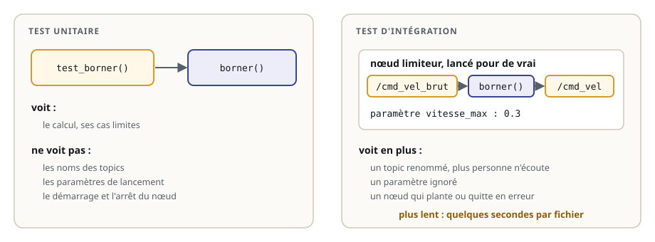
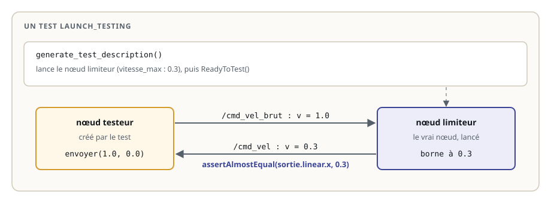
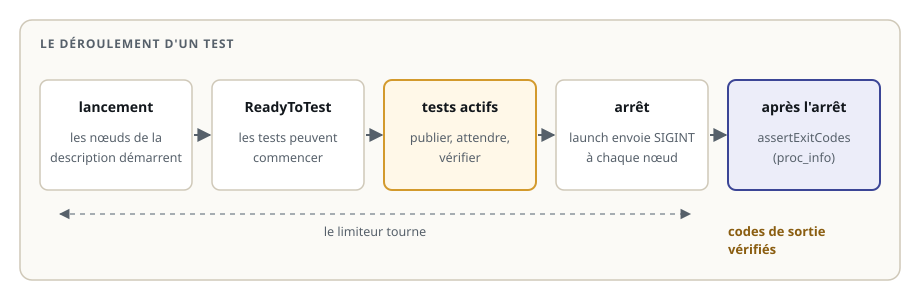

# Tester un nœud avec launch_testing

> **La situation.** Le robot de livraison passe par un **limiteur de vitesse** : un nœud qui borne les commandes avant qu'elles n'atteignent les moteurs. Lors d'un nettoyage du code, un collègue a renommé son topic de sortie en `/cmd_vel_limite`. Les tests unitaires de la fonction de calcul passent tous : le calcul n'a pas changé. Sur le robot, plus rien ne bouge, car les moteurs écoutent toujours `/cmd_vel`. Ce bug-là ne se voit qu'en **lançant le nœud** et en lui parlant par ses topics : c'est un test d'intégration.

**Dans ce module, vous allez :**

- comprendre ce que les tests unitaires ne voient pas : topics, paramètres, lancement et arrêt d'un nœud ;
- écrire un test **launch_testing** qui lance le vrai nœud, lui envoie des messages et vérifie ses réponses ;
- distinguer les tests **actifs**, pendant que les nœuds tournent, et les tests **après l'arrêt** ;
- lancer un nœud avec des **paramètres** choisis pour le test ;
- lancer les tests avec `launch_test` et `colcon test`, et les mesurer avec des mutants.

## L'essentiel en théorie

- Un **test d'intégration** vérifie que plusieurs morceaux fonctionnent **ensemble** : ici, un nœud lancé avec ses paramètres, ses topics et un nœud de test qui lui parle.
- **launch_testing** lance une description de lancement, comme un fichier launch, puis exécute des tests `unittest` pendant que les nœuds tournent.
- La fonction `generate_test_description()` décrit les nœuds à lancer et se termine par l'action `ReadyToTest()`.
- Les tests **actifs** publient des messages et attendent les réponses, toujours avec un **délai maximal**.
- Les tests **après l'arrêt** (`post_shutdown_test`) vérifient les **codes de sortie** : un nœud qui plante ne passe pas inaperçu.

## 1. Ce que les tests unitaires ne voient pas

Le module précédent a testé le calcul seul, sans ROS. C'est rapide et précis, mais une partie du nœud n'est jamais exécutée : son câblage.



Un nom de topic, un paramètre mal lu, un nœud qui plante au démarrage ou à l'arrêt : ce sont des bugs fréquents en robotique, et seul un test qui lance le nœud les attrape. Les deux étages se complètent : beaucoup de tests unitaires, quelques tests d'intégration.

## 2. Le nœud à tester

Le limiteur reçoit les commandes sur `/cmd_vel_brut`, borne la vitesse linéaire entre `-vitesse_max` et `+vitesse_max`, recopie la vitesse de rotation, et publie le résultat sur `/cmd_vel`. Le calcul est une fonction pure, `borner()`, testable avec pytest comme au module précédent :

```python fichier=src/limiteur/limiteur/noeud.py
"""Limiteur de vitesse du robot de livraison : borne la vitesse des commandes avant les moteurs."""

import rclpy
from geometry_msgs.msg import Twist
from rclpy.executors import ExternalShutdownException
from rclpy.node import Node


def borner(valeur, maximum):
    """Ramène valeur dans [-maximum, maximum]."""
    return max(-maximum, min(valeur, maximum))


class Limiteur(Node):
    """Reçoit les commandes sur /cmd_vel_brut, publie sur /cmd_vel la commande bornée."""

    def __init__(self):
        super().__init__('limiteur')
        self.vitesse_max = self.declare_parameter('vitesse_max', 0.5).value
        self.sortie = self.create_publisher(Twist, '/cmd_vel', 10)
        self.create_subscription(Twist, '/cmd_vel_brut', self.recevoir, 10)

    def recevoir(self, commande):
        limite = Twist()
        limite.linear.x = borner(commande.linear.x, self.vitesse_max)
        limite.angular.z = commande.angular.z
        self.sortie.publish(limite)


def main():
    rclpy.init()
    noeud = Limiteur()
    try:
        rclpy.spin(noeud)
    except (KeyboardInterrupt, ExternalShutdownException):
        pass
    finally:
        noeud.destroy_node()
        rclpy.try_shutdown()
```

La fonction `main()` attrape `ExternalShutdownException` : quand launch arrête le nœud avec Ctrl+C (le signal SIGINT), il quitte proprement, avec le code 0. Le test le vérifiera.

## 3. Un premier test launch_testing

Un test launch_testing est un fichier Python en deux parties : la description de ce qu'il faut lancer, puis les tests.



```python fichier=src/limiteur/test/test_limiteur_launch.py
"""Test d'intégration du limiteur : on lance le vrai nœud et on lui parle par ses topics."""

import time
import unittest

import launch
import launch_ros.actions
import launch_testing
import launch_testing.actions
import launch_testing.asserts
import pytest
import rclpy
from geometry_msgs.msg import Twist


@pytest.mark.launch_test
def generate_test_description():
    limiteur = launch_ros.actions.Node(
        package='limiteur', executable='limiteur',
        parameters=[{'vitesse_max': 0.3}],
    )
    return launch.LaunchDescription([limiteur, launch_testing.actions.ReadyToTest()]), {'limiteur': limiteur}


class TestLimiteur(unittest.TestCase):
    """Tests actifs : ils tournent pendant que le limiteur est lancé."""

    @classmethod
    def setUpClass(cls):
        rclpy.init()

    @classmethod
    def tearDownClass(cls):
        rclpy.shutdown()

    def setUp(self):
        self.noeud = rclpy.create_node('testeur')
        self.recus = []
        self.noeud.create_subscription(Twist, '/cmd_vel', self.recus.append, 10)
        self.commandes = self.noeud.create_publisher(Twist, '/cmd_vel_brut', 10)

    def tearDown(self):
        self.noeud.destroy_node()

    def envoyer(self, v, w, delai=5.0):
        """Publie la commande (v, w) jusqu'à recevoir la réponse du limiteur, et la renvoie."""
        commande = Twist()
        commande.linear.x, commande.angular.z = float(v), float(w)
        fin = time.monotonic() + delai
        while time.monotonic() < fin:
            self.commandes.publish(commande)
            rclpy.spin_once(self.noeud, timeout_sec=0.1)
            if self.recus:
                return self.recus[-1]
        self.fail(f'aucun message sur /cmd_vel en {delai} s')

    def test_commande_lente_inchangee(self):
        sortie = self.envoyer(0.2, 0.0)
        self.assertAlmostEqual(sortie.linear.x, 0.2)


@launch_testing.post_shutdown_test()
class TestArret(unittest.TestCase):
    """Tests après l'arrêt : le limiteur s'est-il arrêté proprement ?"""

    def test_arret_propre(self, proc_info):
        launch_testing.asserts.assertExitCodes(proc_info)
```

Dans l'ordre :

- `generate_test_description()` lance le limiteur avec `vitesse_max` à `0.3`, puis `ReadyToTest()` signale que les tests peuvent commencer. Le dictionnaire renvoyé, `{'limiteur': limiteur}`, rend le processus accessible aux tests qui prennent un argument `limiteur` ;
- `setUpClass` et `tearDownClass` initialisent et arrêtent rclpy une fois pour la classe ; `setUp` crée, pour chaque test, un petit nœud `testeur` qui publie sur `/cmd_vel_brut` et écoute `/cmd_vel` ;
- `envoyer()` publie la commande **en boucle** jusqu'à recevoir une réponse, au plus 5 secondes. Juste après le lancement, le limiteur n'est peut-être pas encore abonné : un seul `publish` serait perdu ;
- `TestArret`, décorée par `post_shutdown_test`, s'exécute après l'arrêt : `assertExitCodes(proc_info)` vérifie que chaque processus lancé a quitté avec le code 0.

## 4. Le déroulement d'un test

launch_testing enchaîne toujours les mêmes étapes :



Si un test actif échoue, les autres s'exécutent quand même, puis les nœuds sont arrêtés et les tests après l'arrêt tournent. Le bilan donne le détail de chaque test.

## 5. Paramètres et plusieurs nœuds

La description de lancement accepte tout ce qu'accepte un fichier launch : des paramètres, des remappages, plusieurs nœuds.

```python
launch_ros.actions.Node(
    package='limiteur', executable='limiteur',
    parameters=[{'vitesse_max': 0.3}],                  # une valeur différente de la valeur par défaut
    remappings=[('/cmd_vel_brut', '/teleop/cmd_vel')],  # brancher le nœud sur un autre topic
)
```

Choisissez des paramètres **différents des valeurs par défaut** : lancé avec `0.5`, la valeur par défaut, un limiteur qui ignore son paramètre se comporterait exactement comme le bon. Pour tester plusieurs nœuds ensemble, ajoutez-les à la même `LaunchDescription` : le test vérifie alors leur dialogue de bout en bout.

## 6. Lancer les tests

```bash
cd ~/ws/41-tests-integration
colcon build
source install/setup.bash
export ROS_DOMAIN_ID=42                                  # un domaine à part : les autres nœuds ne gênent pas le test
launch_test src/limiteur/test/test_limiteur_launch.py    # un fichier de test, avec le détail
colcon test --packages-select limiteur                   # tous les tests du package, comme l'intégration continue
colcon test-result --verbose
```

Le `package.xml` déclare ce dont le test a besoin :

```xml
<test_depend>launch</test_depend>
<test_depend>launch_ros</test_depend>
<test_depend>launch_testing</test_depend>
<test_depend>python3-pytest</test_depend>
```

Dans un package Python, `colcon test` trouve le test grâce à pytest et au marqueur `@pytest.mark.launch_test`. Dans un package C++, le `CMakeLists.txt` le déclare avec `add_launch_test()`, du package `launch_testing_ament_cmake`.

## 7. Les bons réflexes

- **attendre une condition, pas une durée** : une boucle avec un délai maximal plutôt qu'un `sleep` fixe, trop court sur une machine chargée ou trop long partout ;
- **un message d'échec clair** : `aucun message sur /cmd_vel en 5 s` dit tout de suite ce qui manque ;
- **toujours vérifier les codes de sortie** après l'arrêt ;
- **un domaine ROS à part** (`ROS_DOMAIN_ID`), pour que d'autres nœuds ne faussent pas le test ;
- **peu de tests d'intégration, bien choisis** : ils sont plus lents que les tests unitaires. Le calcul se teste à l'étage du dessous.

Comme au module précédent, un test ne vaut que par les bugs qu'il attrape. Les mutants s'appliquent aussi au nœud entier : un topic renommé, un paramètre ignoré, un nœud qui quitte en erreur.

## À vous de jouer

Dans l'exercice, le nœud est correct, mais son test d'intégration est celui du cours : il n'envoie qu'une commande lente. Complétez-le pour qu'il attrape cinq versions buggées du limiteur. La vérification vous dit lesquelles passent encore.
