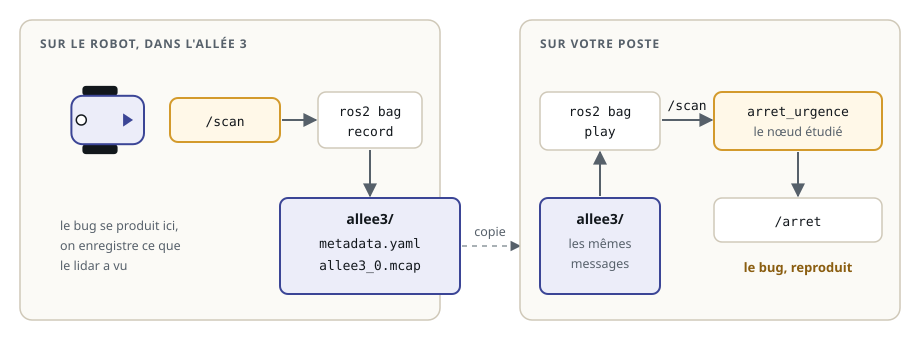
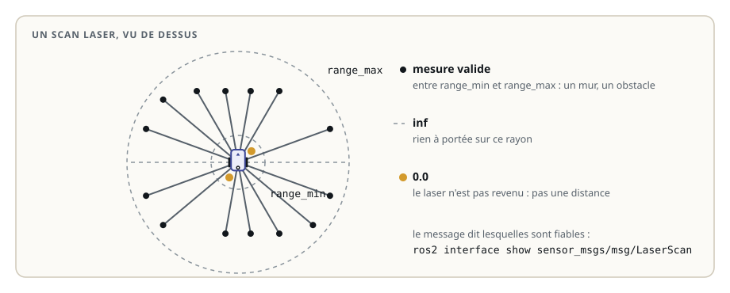
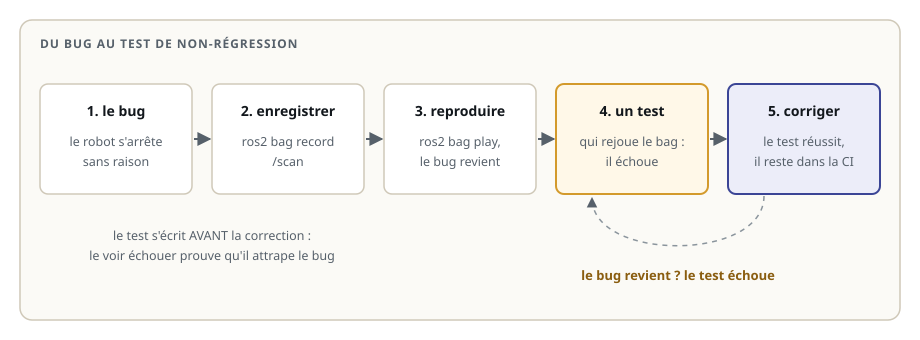

# Rejouer des données avec ros2 bag

> **La situation.** Le robot de livraison s'arrête **sans raison**, par moments, dans l'allée 3 de l'entrepôt. Rien devant lui, et pourtant son nœud d'arrêt d'urgence publie « arrêt ». Sur votre poste, impossible de reproduire : pas d'entrepôt, pas de lidar. La solution du métier : **enregistrer** les données du robot là où le bug se produit, puis les **rejouer** sur votre poste, autant de fois que nécessaire. Et une fois le bug corrigé, faire de cet enregistrement un **test** qui l'empêche de revenir.

**Dans ce module, vous allez :**

- enregistrer des topics avec `ros2 bag record`, et savoir ce que contient un bag ;
- inspecter un enregistrement avec `ros2 bag info`, et le rejouer avec `ros2 bag play` ;
- reproduire un bug en rejouant les données devant le nœud ;
- lire un bag dans un test avec `rosbag2_py`, sans lancer ROS ;
- transformer un bug corrigé en **test de non-régression**.

## L'essentiel en théorie

- Un **bag** est un enregistrement de messages ROS 2 : chaque message d'un topic, avec son heure d'arrivée. C'est un dossier qui contient les données et un fichier de description, `metadata.yaml`.
- `ros2 bag record` enregistre les topics choisis ; `ros2 bag play` les republie, dans le même ordre et au même rythme. Les nœuds qui écoutent ne voient pas la différence avec le vrai robot.
- Rejouer, c'est **reproduire** : le même enregistrement donne le même bug, sur n'importe quel poste.
- Un test peut aussi lire le bag **directement**, avec `rosbag2_py`, et passer chaque message à une fonction : c'est rapide et toujours identique.
- Un **test de non-régression** fige un bug corrigé : il échoue avec le bug et réussit avec la correction.

## 1. Enregistrer

Sur le robot, pendant qu'il roule dans l'allée 3, on enregistre le topic du lidar :

```bash
ros2 bag record -o allee3 /scan            # Ctrl+C pour arrêter l'enregistrement
ros2 bag record -o essai /scan /odom /cmd_vel   # plusieurs topics
```

L'option `-o` donne le nom du dossier créé. `ros2 bag record -a` enregistre **tous** les topics : pratique pour une première fois, mais les images et les nuages de points remplissent vite un disque. Enregistrez ce dont vous avez besoin.



Le dossier `allee3` contient `metadata.yaml`, qui décrit l'enregistrement, et un fichier de données (au format MCAP par défaut dans Jazzy). Il se copie comme n'importe quel dossier : par clé USB, `scp`, ou dans le dépôt Git quand il est petit.

## 2. Inspecter

Avant de rejouer, on regarde ce que contient l'enregistrement :

```bash
ros2 bag info allee3
```

La commande affiche la durée, le nombre de messages, et pour chaque topic son type et son nombre de messages. Un topic absent ou un nombre de messages trop faible (un capteur qui a décroché) se voient tout de suite.

## 3. Rejouer

```bash
ros2 bag play allee3                    # republie /scan, au rythme de l'enregistrement
ros2 bag play allee3 --rate 0.5         # deux fois plus lentement
ros2 bag play allee3 --loop             # en boucle
ros2 bag play allee3 --topics /scan     # seulement certains topics
```

Pendant la lecture, le nœud d'arrêt d'urgence reçoit `/scan` exactement comme sur le robot. Dans un autre terminal, on observe sa décision :

```bash
ros2 run arret_urgence arret_urgence    # terminal 1 : le nœud à étudier
ros2 bag play allee3                    # terminal 2 : les données du robot
ros2 topic echo /arret                  # terminal 3 : la décision, message par message
```

Les messages republiés gardent l'horodatage de leur en-tête (`header.stamp`), celui du jour de l'enregistrement. Pour les nœuds qui comparent ces horodatages à l'heure courante, comme tf2, `ros2 bag play --clock` publie l'horloge de l'enregistrement sur `/clock`, et ces nœuds se lancent avec le paramètre `use_sim_time` à `true`.

## 4. Reproduire et comprendre

Voici le nœud du robot. Sa décision est une fonction pure, `obstacle_proche()`, comme au module des tests unitaires :

```python fichier=src/arret_urgence/arret_urgence/detection.py
"""Décision d'arrêt d'urgence à partir d'un scan laser, sans ROS : testable seule."""


def obstacle_proche(distances, distance_min, distance_max, seuil):
    """Vrai si le laser voit un obstacle à moins de seuil mètres."""
    return min(distances) < seuil
```

```python fichier=src/arret_urgence/arret_urgence/noeud.py
"""Arrêt d'urgence du robot de livraison : publie True sur /arret quand un obstacle est trop proche."""

import rclpy
from rclpy.executors import ExternalShutdownException
from rclpy.node import Node
from sensor_msgs.msg import LaserScan
from std_msgs.msg import Bool

from arret_urgence.detection import obstacle_proche


class ArretUrgence(Node):

    def __init__(self):
        super().__init__('arret_urgence')
        self.seuil = self.declare_parameter('seuil', 0.5).value
        self.arret = self.create_publisher(Bool, '/arret', 10)
        self.create_subscription(LaserScan, '/scan', self.recevoir, 10)

    def recevoir(self, scan):
        proche = obstacle_proche(scan.ranges, scan.range_min, scan.range_max, self.seuil)
        self.arret.publish(Bool(data=bool(proche)))


def main():
    rclpy.init()
    noeud = ArretUrgence()
    try:
        rclpy.spin(noeud)
    except (KeyboardInterrupt, ExternalShutdownException):
        pass
    finally:
        noeud.destroy_node()
        rclpy.try_shutdown()
```

Si le bug apparaît pendant la lecture, il est **reproduit** : on peut maintenant le chercher calmement. Il faut regarder les données elles-mêmes. Un scan laser contient une distance par rayon, et des bornes qui disent quelles mesures sont fiables :



```bash
ros2 interface show sensor_msgs/msg/LaserScan     # la définition du message, avec ses commentaires
ros2 topic echo /scan --field range_min            # pendant la lecture : un seul champ
ros2 topic echo /scan --field ranges               # toutes les distances du scan
```

Lisez la définition du message : ses commentaires disent comment interpréter chaque champ, y compris les distances.

## 5. Un test qui lit l'enregistrement

Rejouer avec `ros2 bag play` est idéal pour observer. Pour un test, on lit plutôt le bag **directement** avec `rosbag2_py` : pas de nœud à lancer, pas de délai, et le même résultat à chaque fois. Dans le lab, enregistrez d'abord le lidar simulé :

```bash
cd ~/ws/42-rejeu-donnees
colcon build && source install/setup.bash
ros2 run arret_urgence lidar_simule                                        # terminal 1
ros2 bag record -o src/arret_urgence/test/donnees/couloir /scan            # terminal 2, Ctrl+C après quelques secondes
```

Puis ce test vérifie l'enregistrement lui-même : 360 mesures par scan, à 10 Hz.

```python fichier=src/arret_urgence/test/test_enregistrement.py
"""Tests sur un enregistrement du lidar : lu directement dans le bag, sans lancer ROS."""

from pathlib import Path
import statistics

import pytest
import rosbag2_py
from rclpy.serialization import deserialize_message
from sensor_msgs.msg import LaserScan

BAG = Path(__file__).parent / 'donnees' / 'couloir'


def lire_scans(chemin):
    """Les scans /scan de l'enregistrement, dans l'ordre : (horodatage en ns, message)."""
    lecteur = rosbag2_py.SequentialReader()
    lecteur.open(rosbag2_py.StorageOptions(uri=str(chemin)), rosbag2_py.ConverterOptions('cdr', 'cdr'))
    scans = []
    while lecteur.has_next():
        topic, donnees, t = lecteur.read_next()
        if topic == '/scan':
            scans.append((t, deserialize_message(donnees, LaserScan)))
    return scans


@pytest.mark.skipif(not BAG.exists(), reason="enregistrez d'abord test/donnees/couloir (voir le cours)")
def test_le_lidar_publie_360_mesures_a_10_hz():
    scans = lire_scans(BAG)
    assert len(scans) >= 10
    assert all(len(scan.ranges) == 360 for _, scan in scans)
    periodes = [(b - a) / 1e9 for (a, _), (b, _) in zip(scans, scans[1:])]
    assert statistics.median(periodes) == pytest.approx(0.1, abs=0.03)
```

```bash
cd src/arret_urgence && python3 -m pytest test     # depuis le package
```

`lire_scans()` ouvre le bag, lit les messages un par un (`read_next()` renvoie le topic, les données sérialisées et l'horodatage en nanosecondes), et les désérialise en `LaserScan`. Chaque message peut ensuite être passé à la fonction à tester.

## 6. Du bug au test de non-régression

Un bug corrigé peut revenir : un collègue « simplifie » le code, et le robot s'arrête de nouveau dans l'allée 3. Le test de non-régression l'en empêche :



L'ordre compte : écrivez le test **avant** de corriger, et vérifiez qu'il **échoue**. Un test qui passe déjà avec le bug ne protège de rien. Puis corrigez, et le test passe. Le petit enregistrement est rangé avec les tests, dans `test/donnees/`, et le test tourne à chaque modification avec `colcon test`, dans l'intégration continue.

## 7. Les bons réflexes

- **notez le contexte** de chaque enregistrement : date, lieu, version du code, ce qui s'est passé ;
- **enregistrez peu de topics**, et coupez l'enregistrement autour du moment intéressant : un petit bag se range avec les tests, un gros va sur un espace de stockage partagé ;
- **lisez le bag dans les tests** avec `rosbag2_py`, plutôt que `ros2 bag play` : pas de minutage, pas de messages perdus ;
- **un bug, un test** : il échoue avant la correction, il réussit après, il reste.

## À vous de jouer

Dans l'exercice, vous recevez l'enregistrement de l'allée 3, rangé dans `test/donnees/allee3`. Rejouez-le, trouvez pourquoi le robot s'arrête sans raison, corrigez la décision, et écrivez le test de non-régression qui le prouve.
