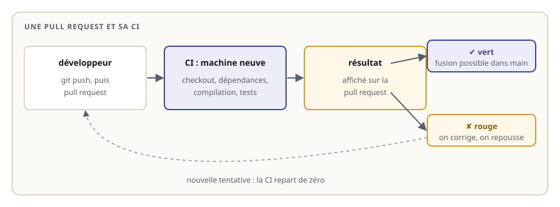
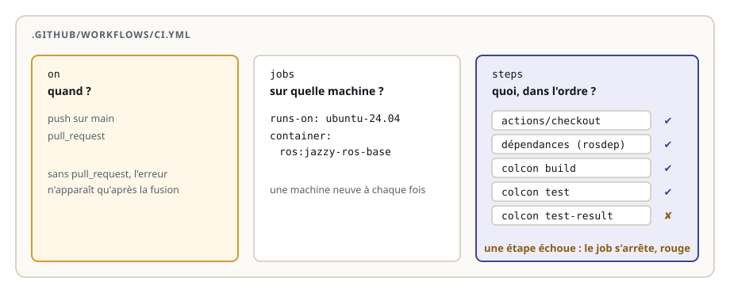
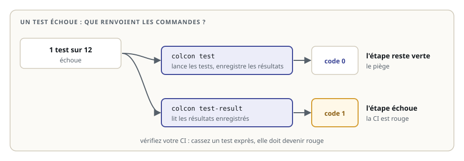

# Intégration continue

> **La situation.** Les tests du robot de livraison existent : tests unitaires, tests d'intégration, tests sur données rejouées. Mais ils ne servent que si quelqu'un les lance. Vendredi soir, une modification fusionnée sans lancer les tests a cassé l'odométrie ; lundi, le robot tournait en rond. L'**intégration continue** (CI) lance automatiquement la compilation et tous les tests à chaque modification proposée, et affiche le résultat sur la pull request, avant la fusion.

**Dans ce module, vous allez :**

- comprendre ce que fait l'intégration continue, et où elle s'insère dans le travail en équipe ;
- écrire un **workflow GitHub Actions** pour un dépôt ROS 2 ;
- éviter le piège classique : une CI **verte** alors que des tests échouent ;
- garder les **mêmes étapes** en local et en CI, avec un script ;
- protéger la branche `main` : pas de fusion tant que la CI n'est pas verte.

## L'essentiel en théorie

- L'**intégration continue** compile et teste le code automatiquement à chaque `push` et à chaque **pull request**, sur une machine propre.
- Sur GitHub, un **workflow** est un fichier YAML rangé dans `.github/workflows/`. Il dit **quand** il se déclenche (`on`), et **quoi** faire (`jobs`, puis des `steps`).
- Une étape réussit si sa commande se termine avec le **code de sortie 0**. Le job échoue dès qu'une étape échoue.
- `colcon test` lance les tests mais **ne renvoie pas d'erreur** quand un test échoue. C'est `colcon test-result` qui le fait.
- Une CI utile est **rapide**, **fiable**, et **obligatoire** : rouge, on ne fusionne pas.

## 1. Ce que fait l'intégration continue



À chaque pull request, la CI part d'une machine **neuve** : elle récupère le code, installe les dépendances, compile, lance les tests, puis affiche une coche verte ou une croix rouge sur la pull request. Deux avantages par rapport aux tests lancés à la main :

- **personne n'oublie** : les tests tournent à chaque fois, pour tout le monde ;
- **pas de « ça marche sur ma machine »** : une machine neuve révèle une dépendance oubliée dans `package.xml` ou un fichier non commité.

## 2. Un workflow pour un dépôt ROS 2

Le workflow vit dans le dépôt, dans `.github/workflows/ci.yml`, et se versionne avec le code :

```yaml
name: CI

on:
  push:
    branches: [main]      # chaque fusion dans main
  pull_request:           # chaque pull request, avant la fusion

jobs:
  compiler-tester:
    runs-on: ubuntu-24.04
    container: ros:jazzy-ros-base          # une machine neuve, avec ROS 2 Jazzy
    defaults:
      run:
        shell: bash
    steps:
      - uses: actions/checkout@v4          # récupère le code du dépôt
      - name: Dépendances
        run: |
          apt-get update
          rosdep update
          rosdep install --from-paths src --ignore-src -y
      - name: Compilation et tests
        run: bash ci.sh
```



Ligne par ligne :

- `on` : le workflow se déclenche à chaque `push` sur `main` **et** à chaque `pull_request`. Sans `pull_request`, une erreur n'est découverte qu'une fois fusionnée ;
- `container` : les étapes tournent dans l'image officielle `ros:jazzy-ros-base`, ROS 2 déjà installé ;
- `actions/checkout` : sans cette étape, la machine ne contient pas votre code ;
- `rosdep install` installe les dépendances déclarées dans les `package.xml`, celles de test comprises : c'est là qu'une dépendance oubliée se voit ;
- chaque étape `run` s'exécute avec `bash -e` : elle échoue dès qu'une de ses commandes échoue.

## 3. Le piège : une CI verte avec des tests rouges

`colcon test` lance les tests de chaque package et enregistre leurs résultats. Mais il se termine avec le code 0 même si des tests échouent : pour lui, les tests **ont tourné**. Une étape qui ne lance que `colcon test` reste donc verte.



C'est `colcon test-result` qui lit les résultats et renvoie un code non nul si un test a échoué. Avec `--verbose`, il affiche aussi le détail de chaque échec dans le journal de la CI. Vérifiez toujours votre CI en cassant un test exprès : elle doit devenir rouge.

## 4. Les mêmes étapes en local et en CI

Si la CI échoue, on veut reproduire l'échec sur son poste, avec exactement les mêmes commandes. On les range dans un script versionné, que le workflow appelle :

```bash fichier=ci.sh
#!/usr/bin/env bash
# Les étapes de l'intégration continue : les mêmes en local et sur GitHub Actions.
set -eo pipefail                     # s'arrête à la première commande qui échoue
source /opt/ros/jazzy/setup.bash
colcon build
colcon test
colcon test-result --verbose         # code de sortie non nul si un test a échoué
```

```bash
cd ~/ws/43-integration-continue
bash ci.sh        # avant de pousser : le même verdict que la CI
```

Le workflow ne contient plus que ce qui dépend de GitHub (déclencheurs, machine, récupération du code), et le script ce qui dépend du projet.

## 5. Protéger la branche main

Une CI qu'on peut ignorer finit ignorée. Dans les réglages du dépôt sur GitHub, une **règle de protection** de la branche `main` peut exiger que la CI soit verte avant toute fusion (« require status checks to pass »), et qu'une revue de code ait approuvé la pull request. La fusion est alors impossible tant que la croix est rouge.

## 6. Aller plus loin

- **les tests de qualité du code** : un package créé avec `ros2 pkg create --build-type ament_python` contient déjà des tests de style (`test_flake8.py`, `test_pep257.py`) et de licence (`test_copyright.py`), que `colcon test` lance comme les autres ;
- **plusieurs distributions** : une matrice (`strategy: matrix:`) lance le même job sur plusieurs images, par exemple deux distributions ROS 2 ;
- **des actions prêtes à l'emploi** : `ros-tooling/action-ros-ci` regroupe dépendances, compilation et tests ;
- **un cache** des dépendances, pour une CI plus rapide.

## 7. Les bons réflexes

- **une CI rapide** : quelques minutes. Les tests lents vont dans un workflow à part, lancé moins souvent ;
- **rouge, on s'arrête** : on corrige avant de faire autre chose, sinon les échecs s'accumulent ;
- **jamais désactiver un test pour passer au vert** : un test rouge signale un bug, ou un test à réparer ;
- **reproduire en local** avec le même script avant de pousser une correction ;
- **casser exprès** un test de temps en temps, pour vérifier que la CI le voit.

## À vous de jouer

Dans l'exercice, le dépôt du robot de livraison a déjà un workflow. Il a l'air de fonctionner, mais il laisse passer des erreurs. Trouvez ses défauts et corrigez-le : la vérification exécute ses étapes, une fois sur le code actuel, une fois avec un test cassé exprès.
