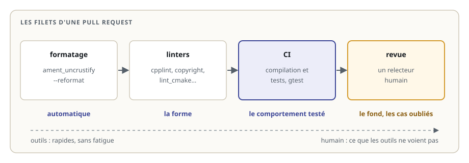
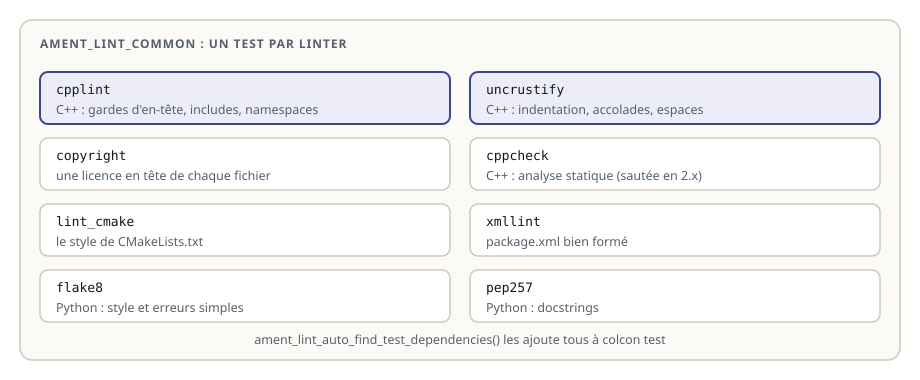
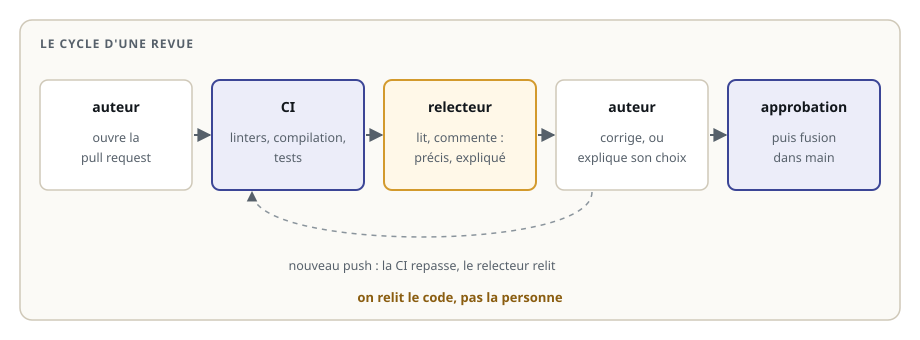

# Qualité du code et revue

> **La situation.** Sam a ouvert une pull request sur le dépôt du robot de livraison : une fonction C++ qui borne la vitesse envoyée aux moteurs. Le code compile, Sam l'a essayé. Mais la CI est rouge : des erreurs de style, un fichier sans licence, et un test unitaire qui échoue. Et la relectrice, Awa, a laissé trois commentaires. Dans ce module, vous apprenez à faire passer une pull request ces deux filets : les **outils automatiques**, puis la **revue humaine**.

**Dans ce module, vous allez :**

- comprendre pourquoi une équipe impose des règles de style et des contrôles automatiques ;
- activer les linters d'ament dans un package, et lire ce qu'ils signalent ;
- corriger le formatage automatiquement avec `ament_uncrustify --reformat` ;
- écrire un test unitaire en C++ avec **gtest** ;
- relire une pull request, et répondre à une revue.

## L'essentiel en théorie

- Un **linter** lit le code sans l'exécuter et signale ce qui s'écarte des règles de l'équipe : style, structure, licence.
- Dans ROS 2, `ament_lint_auto` ajoute à `colcon test` les linters d'`ament_lint_common` : cpplint, uncrustify, copyright, cppcheck, lint_cmake, xmllint, et flake8 et pep257 pour Python.
- Le **formatage** ne se discute pas, il s'applique : `ament_uncrustify --reformat` le corrige tout seul.
- **gtest** est le framework de tests unitaires du C++ : `TEST(groupe, cas)` et des `EXPECT_…`.
- La **revue de code** vérifie ce que les outils ne voient pas : le comportement, les noms, la clarté, les cas oubliés.

## 1. Pourquoi des règles communes

Un dépôt d'équipe est lu bien plus souvent qu'il n'est écrit. Des règles communes font gagner du temps à tout le monde :

- **un style unique** : on lit le code des autres comme le sien, et les différences d'une pull request montrent les vrais changements, pas des espaces ;
- **des erreurs attrapées tôt** : un include manquant, une garde d'en-tête mal nommée, une licence oubliée ;
- **une revue utile** : quand les outils ont vérifié la forme, le relecteur se concentre sur le fond.



## 2. Les linters d'ament dans un package

Un package C++ active tous les linters en trois lignes de `CMakeLists.txt` et une dépendance de test dans `package.xml`. Voici le package `vitesse` complet :

```cmake fichier=src/vitesse/CMakeLists.txt
cmake_minimum_required(VERSION 3.8)
project(vitesse)

if(CMAKE_COMPILER_IS_GNUCXX OR CMAKE_CXX_COMPILER_ID MATCHES "Clang")
  add_compile_options(-Wall -Wextra -Wpedantic)
endif()

find_package(ament_cmake REQUIRED)

add_library(borner src/borner.cpp)
target_include_directories(borner PUBLIC
  $<BUILD_INTERFACE:${CMAKE_CURRENT_SOURCE_DIR}/include>
  $<INSTALL_INTERFACE:include>)

install(DIRECTORY include/ DESTINATION include)
install(TARGETS borner EXPORT export_vitesse
  ARCHIVE DESTINATION lib
  LIBRARY DESTINATION lib)

if(BUILD_TESTING)
  # les tests de qualité : style, copyright, analyse statique (ament_lint_common)
  find_package(ament_lint_auto REQUIRED)
  ament_lint_auto_find_test_dependencies()
  # les tests unitaires en C++
  find_package(ament_cmake_gtest REQUIRED)
  ament_add_gtest(test_borner test/test_borner.cpp)
  target_link_libraries(test_borner borner)
endif()

ament_export_targets(export_vitesse)
ament_package()
```

```xml fichier=src/vitesse/package.xml
<?xml version="1.0"?>
<package format="3">
  <name>vitesse</name>
  <version>0.1.0</version>
  <description>Calculs de vitesse du robot de livraison, en C++, avec leurs tests de qualité</description>
  <maintainer email="etudiant@roboforge.local">etudiant</maintainer>
  <license>Apache-2.0</license>

  <buildtool_depend>ament_cmake</buildtool_depend>

  <test_depend>ament_cmake_gtest</test_depend>
  <test_depend>ament_lint_auto</test_depend>
  <test_depend>ament_lint_common</test_depend>

  <export>
    <build_type>ament_cmake</build_type>
  </export>
</package>
```

`ament_lint_auto_find_test_dependencies()` ajoute un test pour chaque linter déclaré dans les `test_depend`, ici tous ceux d'`ament_lint_common` :



Deux remarques sur Jazzy. `cppcheck` en version 2.x est sauté par défaut, pour des raisons de performances : son test apparaît comme ignoré, et la variable d'environnement `AMENT_CPPCHECK_ALLOW_SLOW_VERSIONS` le réactive. Et `xmllint` valide le `package.xml` contre son schéma quand le fichier en référence un, ce qui demande un accès à Internet.

## 3. Le code, aux normes

L'en-tête porte une **garde** dont le nom suit le chemin du fichier, et un commentaire de licence en tête de chaque fichier :

```cpp fichier=src/vitesse/include/vitesse/borner.hpp
// Copyright 2026 Umoja Roboti
//
// Licensed under the Apache License, Version 2.0 (the "License");
// you may not use this file except in compliance with the License.
// You may obtain a copy of the License at
//
//     http://www.apache.org/licenses/LICENSE-2.0
//
// Unless required by applicable law or agreed to in writing, software
// distributed under the License is distributed on an "AS IS" BASIS,
// WITHOUT WARRANTIES OR CONDITIONS OF ANY KIND, either express or implied.
// See the License for the specific language governing permissions and
// limitations under the License.

#ifndef VITESSE__BORNER_HPP_
#define VITESSE__BORNER_HPP_

namespace vitesse
{

/// Ramène valeur dans [-maximum, maximum] : la vitesse envoyée aux moteurs.
double borner(double valeur, double maximum);

}  // namespace vitesse

#endif  // VITESSE__BORNER_HPP_
```

```cpp fichier=src/vitesse/src/borner.cpp
// Copyright 2026 Umoja Roboti
//
// Licensed under the Apache License, Version 2.0 (the "License");
// you may not use this file except in compliance with the License.
// You may obtain a copy of the License at
//
//     http://www.apache.org/licenses/LICENSE-2.0
//
// Unless required by applicable law or agreed to in writing, software
// distributed under the License is distributed on an "AS IS" BASIS,
// WITHOUT WARRANTIES OR CONDITIONS OF ANY KIND, either express or implied.
// See the License for the specific language governing permissions and
// limitations under the License.

#include <algorithm>

#include "vitesse/borner.hpp"

namespace vitesse
{

double borner(double valeur, double maximum)
{
  return std::max(-maximum, std::min(valeur, maximum));
}

}  // namespace vitesse
```

Ce que les linters demandent ici :

- **la licence** en tête de fichier (copyright) : l'en-tête Apache 2.0, comme la licence déclarée dans `package.xml` ;
- **la garde d'en-tête** `VITESSE__BORNER_HPP_` (cpplint), d'après le chemin `vitesse/borner.hpp` ;
- **inclure ce qu'on utilise** : `std::max` et `std::min` viennent de `<algorithm>` (cpplint) ;
- **les en-têtes standard d'abord**, puis ceux du projet (cpplint) ;
- **pas de `using namespace` dans un en-tête** : il s'imposerait à tous les fichiers qui l'incluent (cpplint) ;
- **le style ROS 2** : deux espaces d'indentation, accolades des fonctions et des namespaces à la ligne (uncrustify).

## 4. Lancer les linters, corriger le style

```bash
cd ~/ws/44-qualite-code
colcon build
colcon test --packages-select vitesse
colcon test-result --verbose          # le détail : quel linter, quel fichier, quelle ligne

ament_cpplint src/vitesse             # un linter seul, plus rapide pendant qu'on corrige
ament_uncrustify src/vitesse          # affiche les différences de style
ament_uncrustify --reformat src/vitesse   # les corrige dans les fichiers
```

Le formatage se corrige tout seul : ne le faites jamais à la main. Les autres messages se corrigent en comprenant la règle. Un linter peut se faire taire (`// NOLINT`, ou une exclusion dans `CMakeLists.txt`), mais seulement pour une vraie exception, expliquée en commentaire et acceptée en revue.

Dans un package Python, `ros2 pkg create --build-type ament_python` crée déjà les tests `test_flake8.py`, `test_pep257.py` et `test_copyright.py`, que `colcon test` lance comme les autres.

## 5. Un test unitaire en C++ avec gtest

gtest joue pour le C++ le rôle de pytest : chaque `TEST(groupe, cas)` est un cas, et les `EXPECT_…` vérifient les résultats. `EXPECT_DOUBLE_EQ` compare deux nombres à virgule avec une tolérance, comme `pytest.approx`.

```cpp fichier=src/vitesse/test/test_borner.cpp
// Copyright 2026 Umoja Roboti
//
// Licensed under the Apache License, Version 2.0 (the "License");
// you may not use this file except in compliance with the License.
// You may obtain a copy of the License at
//
//     http://www.apache.org/licenses/LICENSE-2.0
//
// Unless required by applicable law or agreed to in writing, software
// distributed under the License is distributed on an "AS IS" BASIS,
// WITHOUT WARRANTIES OR CONDITIONS OF ANY KIND, either express or implied.
// See the License for the specific language governing permissions and
// limitations under the License.

#include <gtest/gtest.h>

#include "vitesse/borner.hpp"

TEST(TestBorner, SousLaLimite)
{
  EXPECT_DOUBLE_EQ(vitesse::borner(0.2, 0.5), 0.2);
}

TEST(TestBorner, MarcheAvant)
{
  EXPECT_DOUBLE_EQ(vitesse::borner(2.0, 0.5), 0.5);
}

TEST(TestBorner, MarcheArriere)
{
  EXPECT_DOUBLE_EQ(vitesse::borner(-2.0, 0.5), -0.5);
}
```

Dans `CMakeLists.txt`, `ament_add_gtest(test_borner test/test_borner.cpp)` compile le test et l'ajoute à `colcon test`, puis `target_link_libraries` le relie à la bibliothèque testée. Les bonnes pratiques du module des tests unitaires restent valables : cas limites, symétries, valeurs qui distinguent.

## 6. La revue de code

Quand la CI est verte, un relecteur lit la pull request. Il cherche ce que les outils ne voient pas :

- **le comportement** : la fonction fait-elle ce que dit la description ? Les cas limites sont-ils testés ?
- **la clarté** : les noms disent-ils ce qu'ils représentent ? Un commentaire explique-t-il le pourquoi, là où il n'est pas évident ?
- **la sûreté** : que se passe-t-il avec une valeur négative, nulle, absente ? Sur un robot, une vitesse mal bornée fait bouger les moteurs ;
- **la taille** : une pull request courte, sur un seul sujet, se relit bien. Une pull request de 2 000 lignes se relit mal.



Les commentaires d'une bonne revue sont **précis** (la ligne, le cas qui pose problème), **expliqués** (pourquoi c'est un problème) et **bienveillants** : on relit le code, pas la personne. L'auteur répond à chaque commentaire : il corrige, ou il explique pourquoi il garde son choix.

## 7. Les bons réflexes

- **formatez avant de pousser** : `ament_uncrustify --reformat` ne coûte rien ;
- **lancez `colcon test` en local** : la CI ne doit rien vous apprendre ;
- **ne désactivez pas un linter pour passer** : corrigez ce qu'il signale ;
- **de petites pull requests**, une idée chacune ;
- **relisez comme vous aimeriez être relu** : précis, expliqué, bienveillant.

## À vous de jouer

Dans l'exercice, vous reprenez la pull request de Sam. Le package compile, mais `colcon test` est rouge : rendez-le vert, linters et test unitaire compris, sans rien désactiver.
